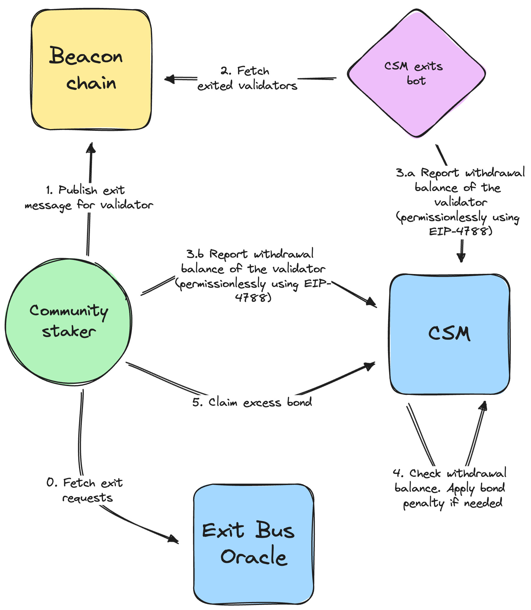

# Validator Exits

:::tip
Looking for a practical guide to run nodes? Follow the [Curated Module v2 guide](/run-on-lido/cm-v2/) or the [CSM guide](/run-on-lido/csm/).
:::

## Exited and Withdrawn

The [Curated module](/contracts/node-operators-registry) uses the "exited" statuses of the validator (both [Slashed and Exited](https://notes.ethereum.org/7CFxjwMgQSWOHIxLgJP2Bw#44-Step-4-Slashed-and-Exited) and [Unslashed and Exited](https://notes.ethereum.org/7CFxjwMgQSWOHIxLgJP2Bw#45-Step-5-Unslashed-and-Exited)) as the last meaningful status in accounting since, after this status, the validator is no longer responsible for any duties on the Beacon chain (except for the rare cases of the delayed sync committee participation).

CMv2 and CSM use the exited-validator count reported by the Accounting Oracle to report active key counts to the Staking Router. For non-slashed validators, CSM settles individual exits using a proof of the withdrawal amount. CMv2 settles them using a proof that the validator has reached its withdrawable epoch.

## Validator balance tracking

The module keeps a **confirmed balance** for each deposited validator key. This is the highest balance proven on the Consensus Layer through the module's verifier. Anyone can submit a balance proof as the validator's balance grows through rewards, settled [top-ups](/staking-modules/node-operators#top-up-queue), consolidation inflows, or other Consensus Layer activity. The confirmed balance is capped at the validator's `MAX_EB`.

When the confirmed balance exceeds the validator's allocated amount, the module raises the allocated amount to match. This keeps tracked stake and remaining [top-up](/staking-modules/node-operators#top-up-queue) capacity up to date.

In CSM, [`Verifier`](/staking-modules/contracts/Verifier) also uses the confirmed balance to check whether a withdrawal is large enough to count as a full withdrawal. The module uses that balance as the baseline for the [withdrawal-balance penalty](/run-on-lido/csm/penalties#what-can-affect-your-bond). Delayed balance proofs can cause the penalty to be measured from an outdated baseline. The penalty measures the shortfall regardless of its cause.

:::warning Prover bot
Confirmed balances stay accurate only if balance proofs are delivered on time, so reliable operation of the [prover bot](https://github.com/lidofinance/csm-prover-tool) is more important to module health than in earlier versions.
:::

## Voluntary exits

Node Operators exit their validators by publishing an exit message to the Ethereum Consensus Layer. Should a Node Operator decide to exit using [EIP-7002](https://eips.ethereum.org/EIPS/eip-7002) instead, they can do so via the [`Ejector`](/staking-modules/contracts/Ejector) contract.

**In CMv2**, exiting outside of a protocol-requested exit is discouraged. Operators planning to do so should notify the Curated Module Committee and the community in advance. **In CSM**, given its permissionless nature, operators can exit at any moment.

:::warning
Exiting validators using [EIP-7002](https://eips.ethereum.org/EIPS/eip-7002) is an emergency measure and should be used only in exceptional cases. It is recommended to exit validators using the standard method of publishing an exit message to the Ethereum Consensus Layer.
:::

## Protocol-initiated exits

For consistency with the core protocol and other staking modules, these modules use [VEBO](/contracts/validators-exit-bus-oracle) to request or trigger validator exits. Details about the overall processes and mechanisms through which validator exits are requested by the protocol and why are explained in the Lido on Ethereum Validator Exits SNOP 3.0 ([IPFS](https://ipfs.io/ipfs/QmW9kE61zC61PcuikCQRwn82aoTCj9yPuENGNPML9QLkSM), [GitHub](https://github.com/lidofinance/documents-and-policies/blob/main/Lido%20on%20Ethereum%20Standard%20Node%20Operator%20Protocol%20-%20Validator%20Exits.md))

From the core protocol side, validator exit can be requested to cover withdrawal requests from stETH holders or according to the DAO's decision.

From the module side, validator exits can be requested or triggered for:
- Unbonded validators. These exits are requested automatically using the `targetLimitMode = 2` (forced mode);
- CSM validators with an excessive number of bad performance strikes. These exits are triggered via the permissionless method on the [`ValidatorStrikes`](/staking-modules/contracts/ValidatorStrikes) contract. The strike parameters are set per Node Operator type, and are documented for CSM under [Penalties](/run-on-lido/csm/penalties#what-can-affect-your-bond).

:::info
`targetLimitMode = 2` (forced mode) was introduced within the updated version of [Staking Router](https://hackmd.io/@lido/BJXRTxMRp#Forced-Exit-Requests1). In short, it is similar to the existing `targetLimit` but exits for the validators above `targetLimit` with `targetLimitMode = 2` (forced mode) can be requested within the next [VEBO](/contracts/validators-exit-bus-oracle) report, even without a need to fulfill withdrawal requests from stETH holders.
:::

Node Operators should follow [VEBO](/contracts/validators-exit-bus-oracle) events, for example by using the [Ejector](https://github.com/lidofinance/validator-ejector), to ensure they exit validators on time.

If a Node Operator fails to exit requested validators in time:
1. VEBO will trigger exits for the delayed validators;
2. The module will penalize the Node Operator's [bond](/staking-modules/node-operators#bond) tokens for the delayed exits;
3. The module will confiscate `withdrawalRequestFee` paid by the protocol to trigger delayed validator exits from the Node Operator's [bond](/staking-modules/node-operators#bond) tokens;

Also, in exceptional cases, Lido DAO can trigger exits for Node Operator's validators based on the DAO's decision.

## Withdrawal balance reporting

The module settles a validator's exit after receiving a withdrawal report. Processing the report marks the validator as withdrawn and applies any exit-related penalties and charges, documented per module under [CMv2 Penalties](/run-on-lido/cm-v2/penalties) and [CSM Penalties](/run-on-lido/csm/penalties).

### Non-slashed validators

After a full withdrawal is included in a beacon block, anyone can submit a [withdrawal proof](/staking-modules/contracts/Verifier#processwithdrawalproof) through [`Verifier`](/staking-modules/contracts/Verifier). Reports are typically submitted by the [prover bot](https://github.com/lidofinance/csm-prover-tool) or the Node Operator.

`Verifier` validates the proof against a beacon block root obtained through [EIP-4788](https://eips.ethereum.org/EIPS/eip-4788) and forwards the proof to the module to process.

If the withdrawal amount is below the [confirmed expected balance](#validator-balance-tracking), the difference is applied as a penalty. The module also settles any previously recorded delayed-exit penalty, bad-performance penalty, and applicable execution-layer withdrawal request fee. Some of these amounts are proportional to the validator's balance while others are flat, as documented for [CMv2](/run-on-lido/cm-v2/penalties#exit-delay-fee) and [0x02 CSM](/run-on-lido/csm/penalties#parameters-by-operator-profile).

### Slashed validators

Slashed validators use a separate permissioned flow because their full losses, including missed rewards, cannot always be determined from the withdrawal amount alone:

1. Anyone can submit a valid proof of the validator's slashed status through [`Verifier.processSlashedProof`](/staking-modules/contracts/Verifier#processslashedproof). This records the slashing in the module but does not settle the withdrawal.
2. A dedicated committee, the [Curated Module Committee](https://research.lido.fi/t/proposal-transition-the-lnosg-into-the-cmc/11341) or the [CSM Committee](https://research.lido.fi/t/community-staking-module-committee/8333) depending on the module, calculates the slashing loss off-chain and submits the validator's exit balance and explicit slashing penalty through an [Easy Track](/guides/easy-track-guide) motion.
3. When the motion is enacted, the module applies the slashing penalty and any other recorded exit penalties or charges, marks the validator as withdrawn, and updates the Node Operator's required bond.

## Useful links

- [EIP-4788](https://eips.ethereum.org/EIPS/eip-4788)
- [EIP-7002](https://eips.ethereum.org/EIPS/eip-7002)
- [Lido on Ethereum Validator Exits SNOP 3.0](https://ipfs.io/ipfs/QmW9kE61zC61PcuikCQRwn82aoTCj9yPuENGNPML9QLkSM)
