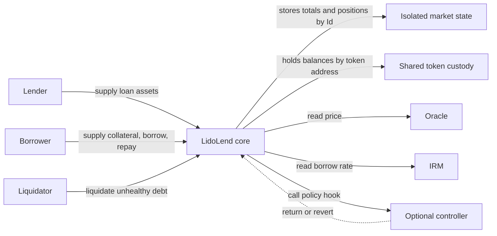

# LidoLend core

`LidoLend` is a fork of [Morpho Blue at commit `1478e9cfe1b4d514f80682b3b60e4e12ff3ee45a`](https://github.com/morpho-org/morpho-blue/tree/1478e9cfe1b4d514f80682b3b60e4e12ff3ee45a). It keeps Morpho's isolated-market accounting and adds owner-only market creation, per-market controller hooks, and a `settle` primitive. This page is for integrators and auditors who already know Morpho Blue and need the fork delta.

:::info Source
Based on [`SPECIFICATION.md`](https://github.com/lidofinance/lend/blob/422d589f9d098124249b54b55306884165833207/SPECIFICATION.md) and [`FORK_NOTES.md`](https://github.com/lidofinance/lend/blob/422d589f9d098124249b54b55306884165833207/FORK_NOTES.md) in `lidofinance/lend` at commit `422d589`. The code at that commit is the final reference.
:::

## Overview

One `LidoLend` contract stores many markets. A market is identified by `Id = keccak256(MarketParams)`, where `MarketParams` contains the loan token, collateral token, oracle, IRM, and LLTV. Positions and totals are isolated by `Id`. Token custody is shared by token address, so a flash loan can use the core's full balance of a token across markets.



The core does the accounting and token transfers. A controller can accept or reject hooked actions. The oracle prices collateral. The IRM returns the borrow rate.

## Inherited behavior

The fork keeps the Morpho Blue accounting model. The [Morpho Blue whitepaper](https://github.com/lidofinance/lend/blob/422d589f9d098124249b54b55306884165833207/morpho-blue-whitepaper.pdf) explains it in full.

**Shares.** Lenders receive supply shares and borrowers incur borrow shares. Conversions use `VIRTUAL_ASSETS = 1` and `VIRTUAL_SHARES = 1e6`. Credits and outputs generally round down. Required inputs, debits, and share burns generally round up.

**Interest.** Interest accrues lazily. Most actions accrue first. Anyone can call `accrueInterest`. `supplyCollateral` does not accrue. For an elapsed interval of `t` seconds, the core gets a per-second WAD rate `r` from the IRM and applies `wTaylorCompounded(r, t)`, the first three non-zero Taylor terms of `e^((r / 1e18) * t) - 1`. The same interest increases total borrow assets and total supply assets. A non-zero market fee mints supply shares to `feeRecipient`. A zero-address IRM accrues no interest.

**Health.** A borrower is healthy when its debt, rounded up, is at most its collateral value, rounded down, multiplied by `LLTV`.

**Liquidation.** For an unhealthy position, the liquidation incentive factor depends on the LLTV. Ignoring rounding, a liquidator receives collateral worth `LIF` times the repaid debt. If collateral runs out and debt remains, the core removes that debt from both total borrow assets and total supply assets, so lenders bear it.

**Authorization.** An authorized operator can reduce another account's supply, increase its debt, withdraw its collateral, or call `settle` for it. Authorization is global to the core, not scoped to a market or an action. Supplying, repaying, or adding collateral for another account needs no authorization.

Ignoring intermediate WAD rounding, the incentive factor is:

```text
LIF = min(1.15, 1 / (1 - 0.3 * (1 - LLTV)))
```

Exhausting collateral can repay at most `collateralValue / LIF`. A loss can therefore occur while the debt is still at or below the full collateral value.

## What the fork changes

| Area | Morpho Blue | `LidoLend` |
|---|---|---|
| Contract | `src/Morpho.sol` | `src/LidoLend.sol` |
| `MarketParams`, positions, totals, `Id` | Five-field `MarketParams` | Unchanged shapes and derivation |
| Market creation | Permissionless for enabled IRMs and LLTVs | Owner only, two overloads |
| `enableIrm`, `enableLltv` | Owner enables values before creation | Removed. `isIrmEnabled` and `isLltvEnabled` now mean "used by at least one created market" |
| Controller hooks | None | Nine market actions call the bound controller under one transient lock |
| Settlement | None | New `settle` function |
| Deployment | Direct, owner set in constructor | Behind a proxy; `initialize(newOwner)` sets the owner once |
| Storage | Slots 0–8 | Slots 0–8 unchanged, fork fields appended at slots 9–11 |
| Compiler and EVM | Solidity 0.8.19 | Solidity 0.8.36, Cancun (transient storage) |

User action signatures and the `onMorpho*` callbacks are preserved, except for the added `settle`.

## Market creation

The core stores two values outside `MarketParams`:

| Value | Rule |
|---|---|
| `marketController[id]` | Optional. Bound at creation. |
| `isSettlementEnabled[id]` | Can be enabled only by the creation call that binds a controller. |

The owner has two creation paths:

- `createMarket(params)` creates a market without a controller and with settlement disabled;
- `createMarket(params, controller, enableSettlement)` requires a non-zero controller whose `marketId()` equals the new market id.

Creation rejects an LLTV at or above 100% and an existing market. A non-zero IRM receives one `borrowRate` call after the market state is stored. The core ignores the returned rate; only a revert rejects creation.

Keeping the controller outside `MarketParams` preserves the upstream market id, but one parameter set can then have only one controller. This is why creation is owner-only. The controller and settlement setting can change only through a core upgrade.

## Controller hooks

A controller exposes `marketId()` and `on(id, event, payload)`. The `HookEvent` values are `Supply`, `Withdraw`, `Borrow`, `Repay`, `SupplyCollateral`, `WithdrawCollateral`, `Liquidate`, `AccrueInterest`, and `Settle`. A revert from `on` rejects the whole action, and the core has no bypass. A successful return does not skip the core's own health and liquidity checks.

Every action that reaches the internal hook dispatch checks one global transient lock, including actions on markets without a controller. When a controller exists, the core sets the lock, calls `on`, and clears the lock after a successful return. A nested hooked action during `on` reverts with `hook reentrancy`, even on another market. `flashLoan`, authorization functions, ERC-20 calls, and owner-only functions do not use the lock.

The controller interface does not authenticate callers. A production controller must check that `msg.sender` is the expected core. `LidoLendMarketController` does this.

### Action timing

The hook runs before the action's position writes, accounting writes, callback, and token transfer.

| Action | State visible to the hook |
|---|---|
| `supply`, `withdraw`, `borrow`, `repay` | Post-accrual market totals and the position before the action |
| `withdrawCollateral`, `liquidate`, `settle` | Post-accrual state and resolved action amounts, before the action writes |
| `supplyCollateral` | Current state without interest accrual, before the collateral increase |
| External `accrueInterest` | Pre-accrual state; the hook runs first |

The owner-only `setFee` path accrues with the old fee without an `AccrueInterest` hook. The fee shares that accrual mints do not dispatch a `Supply` hook. A controller that mirrors market totals must account for both.

`supply`, `repay`, `supplyCollateral`, and `liquidate` can call `onMorpho*` on `msg.sender` when callback data is non-empty. By then the hook has returned and the lock is clear, so a nested action in the callback runs its own hook. A `flashLoan` started by a controller from inside `on` keeps the lock set, so a nested hooked action reverts.

The numeric order of `HookEvent` and the layout of the hook payload structs are ABI boundaries for deployed controllers.

## Settlement entry point

`settle` burns a supply owner's shares to cancel a borrower's debt and sends collateral of equal oracle value to a receiver. No loan tokens move, so settlement can run when an equal loan-token withdrawal cannot. The market must have settlement enabled at creation, and its controller can reject each call. The controller policy is on the [Settlement and lender exits](./settlement) page.

```solidity
function settle(
    MarketParams memory marketParams,
    uint256 borrowShares,
    address onBehalf,
    address borrower,
    address receiver
) external returns (
    uint256 seizedAssets,
    uint256 borrowAssetsCanceled,
    uint256 borrowSharesCanceled,
    uint256 supplySharesBurned
);
```

`onBehalf` owns the burned supply shares. `msg.sender` must be `onBehalf` or an operator authorized by it. The borrower does not approve the settlement, and `receiver` can be any non-zero address.

### Amounts

The caller passes an exact borrow-share amount `B`. All formulas use market totals after interest accrual. `oraclePrice` uses the `1e36` scale adjusted for token decimals.

```text
borrowAssetsCanceled = ceil(B * (totalBorrowAssets + 1) / (totalBorrowShares + 1e6))
borrowAssetsDown     = floor(B * (totalBorrowAssets + 1) / (totalBorrowShares + 1e6))
supplySharesBurned   = ceil(borrowAssetsCanceled * (totalSupplyShares + 1e6) / (totalSupplyAssets + 1))
seizedAssets         = floor(borrowAssetsDown * 1e36 / oraclePrice)
```

No liquidation incentive applies. Before the hook, the core checks the amounts against the supplier's shares and the borrower's debt and collateral, and requires `seizedAssets` to be non-zero. The controller receives these amounts in `SettleHookData`. If the hook accepts, the core applies:

```text
position[id][onBehalf].supplyShares -= supplySharesBurned
market[id].totalSupplyShares        -= supplySharesBurned
market[id].totalSupplyAssets        -= borrowAssetsCanceled

position[id][borrower].borrowShares -= B
market[id].totalBorrowShares        -= B
market[id].totalBorrowAssets         = max(0, market[id].totalBorrowAssets - borrowAssetsCanceled)

position[id][borrower].collateral   -= seizedAssets
```

The core then transfers `seizedAssets` collateral-token units to `receiver`.

### Rounding

| Step | Effect |
|---|---|
| Borrow-share valuation | `borrowAssetsCanceled` rounds up and `borrowAssetsDown` rounds down. They differ by zero or one raw unit. The supply claim uses the higher value and the collateral payout uses the lower one. |
| Collateral conversion | `seizedAssets` rounds down to whole raw collateral units. The borrower keeps the discarded fraction. |
| Supply-share conversion | `supplySharesBurned` rounds up. The extra fraction stays with the remaining supply shares. |

`borrowAssetsCanceled` can equal `totalBorrowAssets + 1`. The core then floors `totalBorrowAssets` at zero but subtracts the full amount from `totalSupplyAssets`, so free liquidity falls by one raw unit.

### Health and debt clearing

`settle` does not check borrower health. Ignoring rounding, it removes the same value from debt and collateral. For a partial cut, LTV falls when it starts below 100%, stays at 100%, and rises when it starts above 100%.

Some debt cannot be cleared through `settle`:

- if settling all remaining borrow shares gives `seizedAssets == 0`, the core rejects the call, and `repay` is the way to clear that debt;
- if settlement takes all collateral before all borrow shares are canceled, the remaining shares stay as debt. A liquidator can then add one raw collateral unit for the borrower and liquidate it in the same transaction, which triggers the bad-debt write-off.

The core has no standalone write-off function.

## Proxy and storage

The implementation constructor sets `isInitialized = true` in its own storage, so the implementation cannot be initialized directly. A fresh proxy calls `initialize(newOwner)` once. Initialization rejects a zero owner and emits `SetOwner`.

`DOMAIN_SEPARATOR()` is computed from `block.chainid` and `address(this)` on every call, so EIP-712 authorization signatures are bound to the proxy address.

| Slots | Variables | Origin |
|---|---|---|
| 0–8 | `owner`, `feeRecipient`, `position`, `market`, `isIrmEnabled`, `isLltvEnabled`, `isAuthorized`, `nonce`, `idToMarketParams` | Morpho, unchanged order |
| 9 | `marketController` | Fork |
| 10 | `isSettlementEnabled` | Fork |
| 11 | `isInitialized` | Fork |

New persistent fields must be appended after slot 11. The hook lock is `transient` and uses no persistent slot.

## Parameters

| Parameter | Meaning | Who can change it | Bounds |
|---|---|---|---|
| `fee` (per market) | Share of accrued interest minted to `feeRecipient` as supply shares | Core owner | At most `MAX_FEE = 0.25e18` (25%) |
| `feeRecipient` | Receiver of fee shares in all markets | Core owner | Any address. Changing it before accrual sends pending fee shares to the new recipient. |
| `lltv` (per market) | Liquidation loan-to-value | Fixed at creation | Below `1e18` (100%) |
| `marketController`, `isSettlementEnabled` | Controller binding and settlement switch | Fixed at creation | Changeable only by a core upgrade |
| `VIRTUAL_ASSETS`, `VIRTUAL_SHARES` | Share-conversion offsets | Fixed in code | `1` and `1e6` |

The fee recipient at launch is on the [roles page](../governance/roles-and-permissions).

## Permissions

| Actor | Powers |
|---|---|
| Core owner (`LidoLendOwner` in the standard deployment) | Creates markets, sets market fees and `feeRecipient`, transfers ownership. Setting the owner to zero disables market creation and fee changes unless the proxy is upgraded. |
| Proxy admin | Replaces the core implementation until the proxy is ossified. |
| Authorized operator | Acts for the authorizing account in every market of the core. |

See [Roles and permissions](../governance/roles-and-permissions) for role holders.

## Trust assumptions and limitations

| Actor or dependency | Assumption |
|---|---|
| Proxy admin | Has full power over state and funds while upgrades are possible. |
| Owner | Creates markets and changes fees within `MAX_FEE`. |
| Controller | Can reject every hooked action in its market. A faulty controller can halt those actions. Binding grants no allowance, authorization, or ownership. |
| Oracle | Returns a strictly positive price at the `1e36` scale. It must not revert or return values that overflow core arithmetic. |
| IRM | Must not reenter or revert, and must not return a rate that overflows interest accrual. |
| Tokens | Must not reenter, rebase, burn the core's balance, or charge transfer fees. Transfer-gated tokens can reject ineligible actors. |
| Callback implementer | Runs arbitrary code before the action's final incoming transfer and must leave enough balance and allowance for it. |

The inherited safety model assumes an oracle price cannot fall at once below its previous value multiplied by `LLTV * LIF`. A larger jump can move a position past the collateral-exhaustion boundary before liquidation can act. Share totals must fit in `uint128`, which puts the practical bound near `1e32` raw loan-token units.

Settlement assumes that, while an external loan-to-collateral route such as staking is available and within its caps, that route returns at least as much collateral as settlement for the same value. If the route is capped or unavailable, settlement can be more attractive to lenders. The core neither uses nor checks that route.

## Related

- [Architecture overview](../architecture)
- [Market controller](./market-controller)
- [Settlement and lender exits](./settlement)
- [Liquidations guide](../guides/liquidations)
- [Core specification on GitHub](https://github.com/lidofinance/lend/blob/422d589f9d098124249b54b55306884165833207/SPECIFICATION.md)
- [Fork notes on GitHub](https://github.com/lidofinance/lend/blob/422d589f9d098124249b54b55306884165833207/FORK_NOTES.md)
- [Generated API reference on GitHub](https://github.com/lidofinance/lend/blob/422d589f9d098124249b54b55306884165833207/API_REFERENCE.md)
