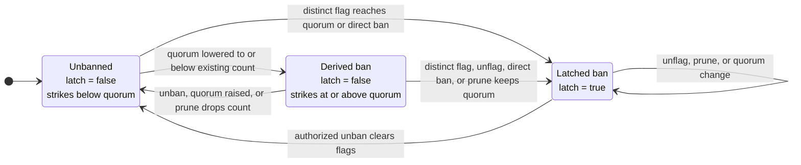

# Guardian signals

`GuardianSignals` stores guardian reports that market controllers use to restrict borrowing and delay collateral activation. The registry does not call the lending core or move tokens. This page covers the onchain registry. The offchain guardian daemon and its operation are covered in the [guardian operator guide](../guides/guardian-operator).

:::info Source
Based on [`docs/specs/guardian-signals.md`](https://github.com/lidofinance/lend-markets/blob/main/docs/specs/guardian-signals.md). The deployed code is the final reference.
:::

## Overview

Guardians publish three kinds of report:

- a **flag** adds one strike, and flags from enough distinct guardian identities ban the account;
- a **suspect report** can add activation delay but never bans;
- a **heartbeat** reports how far the guardian has reviewed protocol activity.

The registry combines current heartbeat timestamps into a candidate **quorum frontier** and stores only forward progress. Controllers use the stored frontier to decide whether collateral can become active. The activation rules themselves are on the [Market controller](./market-controller#collateral-activation) page.

## Registry scope

One registry represents one guardian committee and can serve several markets.

| State | Scope |
|---|---|
| Flags and suspect reports | One `(marketId, account)` pair |
| Guardian membership and delegates | Whole registry |
| Quorum and suspect window | Whole registry |
| Heartbeats and stored quorum frontier | Whole registry |

Heartbeats are shared, so guardians must review every market whose controller uses the registry. A market that needs its own committee, configuration, or scan frontier uses a separate registry.

The registry keys account reports by `marketId` without a core address, and it does not validate market ids. A deployment should keep each registry within one core, or reports for identical market ids in different cores merge.

### What the controller reads

For one `(marketId, account)` pair, `getOpinion` returns:

| Field | Controller effect |
|---|---|
| `banned` | Blocks borrowing and stops an activating lot from maturing |
| `strikeCount` | Adds `strikeCount * delayPerStrike` to the lot's activation delay |
| `suspectCount`, `suspectExpiryTimestamp` | Add `suspectCount * delayPerSuspect` when the lot started before the snapshot expiry |
| `quorumFrontierTimestamp` | Gates maturation after the activation delay has passed |

A borrow checks the caller, the debt owner, and the receiver for a ban. The debt owner's other fields affect only collateral activation.

A ban does not directly block repayment, liquidation, settlement, or a debt-free collateral withdrawal. It does stop maturation, so while an activation lock is live, the unmatured collateral can delay a withdrawal of the inactive balance until the lock expires. The active balance stays withdrawable.

## Guardian identities and delegates

A guardian is one address in the committee. It can appoint one delegate with `setDelegate`. Only the guardian can change its delegate directly, and removing or replacing the guardian clears it. Signal and heartbeat calls name an `onBehalf` guardian, and the caller must be that guardian or its current delegate.

Reports and heartbeats are stored under the guardian identity, so replacing a delegate keeps the guardian's state. Each guardian contributes at most one flag and one suspect report per `(marketId, account)`.

Active delegate addresses are unique. `setDelegate` rejects a non-zero delegate that is a guardian or that any guardian already uses. `addGuardian` and `replaceGuardian` reject a new guardian that is currently a delegate. Replacing a guardian with its own delegate is allowed, because removal clears the pairing first. One signing address therefore cannot represent two committee identities.

## Flags, strikes, and bans

Each distinct guardian flag adds one strike:

```text
effective ban = latched ban || strikeCount >= current quorum
```

| Ban type | When it exists | How it ends |
|---|---|---|
| Latched ban | Written when a new flag reaches quorum, or when `ACCESS_LIMITER_ROLE` bans the account with `ban` | Only `unban` by `ACCESS_RESTORER_ROLE`, which also clears all flags for the account |
| Derived ban | Current flags meet a newly lowered quorum, but no latch is written | Raising quorum, pruning that drops the count, or `unban` |

A guardian cannot retract an account out of an effective ban. Before `unflag` removes anything, it writes the latch if the account is already banned. `unban` leaves suspect reports unchanged.



Quorum must stay between one and the current guardian count. Changing it does not scan accounts or write latches.

## Suspect reports

A suspect report can delay collateral activation but cannot ban. The controller does not scan reports. It reads a cached snapshot:

```text
suspectCount           = reports still active when the snapshot was rebuilt
suspectReportedAt      = latest timestamp among those reports
suspectExpiryTimestamp = suspectReportedAt + current suspectWindow
```

A report is still active when `reportedAt + suspectWindow == block.timestamp` and expires after that. The controller applies the snapshot to an activating lot when:

```text
activatingStart < suspectExpiryTimestamp
```

The lot's start time decides whether the extra delay applies. Once it applies, waiting for the report to expire does not shorten that lot's delay. A zero suspect window does not disable reports: a report at time `t` can still affect a lot that started before `t`. Setting the controller's `delayPerSuspect` to zero removes the added delay.

| Action | Effect on the snapshot |
|---|---|
| `suspect` | Removes expired reports, adds or refreshes one report, and rebuilds the snapshot |
| `unsuspect` | Removes expired reports and the named live report, then rebuilds if anything was removed |
| `prune` removes a former guardian's report | Rebuilds from the remaining current guardians |
| `getOpinion` | No cleanup; returns the cached count with an expiry computed from the current window |

Refreshing one report can extend the expiry for every report counted with it. Changing `suspectWindow` changes the returned expiry at once but does not recount `suspectCount` until the next rebuild.

> **Example.** With a one-hour window, guardian A reports at 10:00, giving `{count: 1, expiry: 11:00}`. Guardian B reports at 10:30, giving `{count: 2, expiry: 11:30}`. B retracts at 10:45, and the snapshot returns to `{count: 1, expiry: 11:00}`.

## Guardian removal and pruning

Removing a guardian revokes its authority at once and clears its delegate and heartbeat. Removal cannot reduce the committee below quorum. It does not scan markets and accounts, so the guardian's flags and suspect reports stay stored. Flags keep counting until pruning or `unban`.

Anyone can call `prune(marketId, account)` for an affected pair. Pruning removes signals from addresses outside the current committee and never clears a latched ban. There is no onchain list of affected pairs, so operators find them from events or an indexer. If a former guardian is re-added before pruning, its old signals stay with that identity.

## Heartbeats and the quorum frontier

For current guardians, the live frontier candidate is the quorum-th highest stored heartbeat timestamp. For example, with five guardians, quorum three, and timestamps `100, 95, 90, 80, 70`, the candidate is `90`.

The registry stores the highest candidate ever recorded. The stored frontier never moves backward, including after a guardian removal, a replacement, a quorum change, or a lower live candidate.

A heartbeat recomputes the candidate only when that guardian moves from at or below the stored frontier to above it. Membership and quorum changes do not recompute it. Anyone can call `syncQuorumFrontier` to recompute; it raises the stored value only when the candidate is higher.

The controller lets a lot mature only when the market is not frozen, the borrower is not banned, `block.timestamp >= unlockTime`, and either the stored frontier has reached `unlockTime` or `activatingStart + maxGuardiansQuorumDelay` has passed.

The fallback deadline stops guardian silence from locking activation forever, but it allows maturation without new scan evidence after the deadline. This is an accepted liveness trade-off.

`GuardianSignals` has no freeze or pause. Reports, configuration, and frontier progress continue while a controller is stopped.

### Heartbeat validation

A heartbeat contains a block hash, a block number, and a guardian-supplied scan timestamp. The registry accepts it only when:

- the block number is not in the future;
- the non-zero hash equals `blockhash(number)`;
- the timestamp is not in the future;
- the timestamp is not below that guardian's stored heartbeat.

The EVM returns zero for the current block and for blocks outside the `blockhash` window, so neither can pass. The block number and hash prove the referenced block is recent; they do not authenticate the timestamp. Only the timestamp is stored. The block number stays in the event.

A heartbeat also carries a `bytes` payload that the registry does not read, validate, or store. It is emitted in the `Heartbeat` event, so guardians can publish scan metadata such as a report digest or a tooling version. Treat it as unauthenticated guardian-supplied data.

The frontier uses the guardian-supplied timestamp without checking it against the block header. A party that controls the configured quorum of guardian identities can advance the frontier without having scanned through that time. Quorum can be one, and delegate uniqueness separates only addresses: one operator can still hold the keys of several identities.

## Parameters

| Parameter | Meaning | Who can change it | Bounds |
|---|---|---|---|
| Guardian set | Committee addresses | `MANAGER_ROLE` (`addGuardian`, `replaceGuardian`, `removeGuardian`) | At most `MAX_GUARDIANS_COUNT = 32`; cannot drop below quorum |
| `quorum` | Distinct flags for a ban, and the heartbeat rank for the frontier | `MANAGER_ROLE` (`setQuorum`) | Between 1 and the current guardian count |
| `suspectWindow` | How long a suspect report stays active | `MANAGER_ROLE` (`setSuspectWindow`) | `0` to `MAX_SUSPECT_WINDOW = 30 days` |
| Delegate | Address that can report for a guardian | The guardian (`setDelegate`) | Unique; never a guardian address |

The activation surcharges `delayPerStrike`, `delayPerSuspect`, and `maxGuardiansQuorumDelay` are controller parameters. See [Market controller](./market-controller#parameters).

## Permissions

| Role or actor | Powers | Initial holder |
|---|---|---|
| `DEFAULT_ADMIN_ROLE` | Grant and revoke registry roles | Lido DAO Agent |
| `MANAGER_ROLE` | Change the guardian set, quorum, and suspect window | `LidoLendOwner` |
| `ACCESS_LIMITER_ROLE` | Ban one account in one market without guardian quorum | No initial holder |
| `ACCESS_RESTORER_ROLE` | Clear a ban for one account in one market | `LidoLendOwner` |
| Guardian | Appoint its delegate; report flags, suspect reports, and heartbeats under its identity | Configured guardian set |
| Guardian delegate | Report under the guardian's identity | None until a guardian appoints one |
| Any account | `prune`, `syncQuorumFrontier` | Permissionless |

Roster, quorum, and suspect-window changes affect every market that shares the registry. `unban` stays keyed by market id. The registry is deployed behind an `OssifiableProxy` whose admin is the Lido DAO Agent. See [Roles and permissions](../governance/roles-and-permissions) and [Committees](../governance/committees).

## Trust assumptions and limitations

- guardians that control the quorum of identities can ban accounts from borrowing and can advance the frontier without real scan progress;
- the quorum-delay fallback allows collateral to activate without new scan evidence;
- heartbeat timestamps and payloads are guardian-supplied and not authenticated against block headers;
- removed guardians' signals persist until someone prunes the affected pairs;
- unpruned signal history can push pruning and `unban` past the block gas limit;
- one registry's state is shared by every market that uses it.

## Related

- [Architecture overview](../architecture)
- [Market controller](./market-controller)
- [Guardian operator guide](../guides/guardian-operator)
- [Committees](../governance/committees)
- [Full guardian signals specification on GitHub](https://github.com/lidofinance/lend-markets/blob/main/docs/specs/guardian-signals.md)
