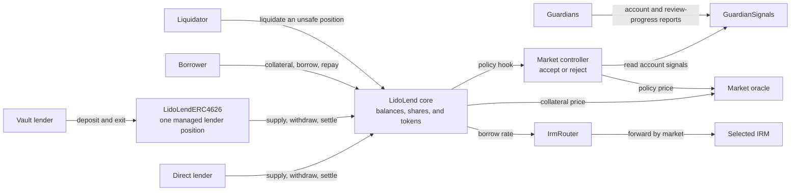

# Lido Lend architecture

Lido Lend is an isolated-market lending protocol built on a fork of Morpho Blue. Each market lets lenders supply one loan token and lets borrowers borrow that token against one collateral token. This page gives integrators, auditors, and advanced users the system model and links to one page per mechanism.

The shared `LidoLend` core keeps the canonical balances and accounting for every market. The Lido-specific contracts add per-market policy (`LidoLendMarketController`), guardian reports (`GuardianSignals`), tokenized lender vaults (`LidoLendERC4626`), and new lender exit paths. They do not keep a second copy of market balances.

:::info Source
Based on [`docs/specs/architecture.md`](https://github.com/lidofinance/lend-markets/blob/main/docs/specs/architecture.md). The deployed code is the final reference.
:::

## Overview

Each market selects a loan token, a collateral token, an oracle, an interest-rate model (IRM), and a liquidation loan-to-value (LLTV). The oracle values collateral in loan-token units. The IRM sets how debt and lender claims grow over time. The LLTV is the borrowing limit that the core health check uses.



The core is the source of truth for supply shares, borrow shares, collateral, market totals, and token custody. A direct lender owns a supply position in the core. A vault combines deposits into one core supply position and gives depositors transferable ERC-4626 shares.

In a market with a controller, the core calls the controller before most market actions. The controller applies the supply cap, collateral-activation rules, guardian signals, freeze and pause state, and settlement policy. It can allow the action or revert, but it cannot change the amounts that the core calculates. Binding a controller does not let that address spend user tokens or act for user accounts.

`GuardianSignals` stores guardian reports about accounts and how far the guardian committee has reviewed protocol activity. The controller uses those reports to block new borrowing or delay collateral activation. `GuardianSignals` does not call the core or move tokens.

## Components

| Component | What it does | Details |
|---|---|---|
| `LidoLend` | Forked Morpho Blue core. Stores all markets, positions, and token balances. Adds owner-only market creation, controller hooks, and `settle`. | [Core](./core) |
| `LidoLendMarketController` | Per-market policy: supply cap, collateral activation, guardian gating, freeze, pause, settlement queue, borrow-share-rate guard. | [Market controller](./market-controller) |
| `GuardianSignals` | Registry of guardian flags, suspect reports, bans, and heartbeats. One registry can serve several markets. | [Guardian signals](./guardian-signals) |
| `LidoLendERC4626` | ERC-4626 vault that holds one managed supply position in one market. Adds targeted settlement and fallback exit. | [Settlement and lender exits](./settlement) |
| `IrmRouter`, `AdaptiveCurveIrm` | Stable IRM address in `MarketParams` and the model it routes to. | [Interest-rate model](./interest-rate-model) |
| `LidoLendOwner` | Governance entry contract. Owns the core and dispatches controller and registry calls. | [Roles and permissions](../governance/roles-and-permissions) |
| `RiskStewardDashboard` | Lets per-market stewards tighten activation rules, revoke instant activation, and freeze a market. | [Market controller](./market-controller#freeze-and-pause) |
| `LidoLendMarketFactory` | Optional helper that deploys standard controllers, vaults, and `GuardianSignals` instances. | [Market creation](#market-creation-and-later-changes) |
| [`CircuitBreaker`](/contracts/circuit-breaker) | Lets a registered emergency actor pause a controller for a limited period. | [Market controller](./market-controller#freeze-and-pause) |

## Market identity and shared scope

The core identifies a market by the five `MarketParams` fields:

```text
marketId = keccak256(abi.encode(loanToken, collateralToken, oracle, irm, lltv))
```

Positions, collateral, and supply and borrow totals are isolated by `marketId`. Assets in one market do not back positions in another market.

The controller address and settlement enablement are not part of `MarketParams`. The core stores both when the market is created and has no setter for them. A market without a controller skips Lido policy. Settlement can be enabled only when a controller is bound.

Accounting isolation does not make every dependency or permission market-specific:

- one core contract and one owner serve all markets in that core;
- core authorization is global: an operator that an account authorizes can act for that account in every market of the core, subject to each action's normal checks;
- token custody is shared by token address, so a token-wide failure can affect every market that uses that token;
- an oracle, IRM router or model, or `GuardianSignals` instance can serve several markets, so a failure or a privileged change can affect every market that uses it;
- `GuardianSignals` does not include the core address in its state keys, so a deployment should keep each registry within one core.

## Main user flows

### Borrowing and liquidation

1. the borrower transfers collateral to the core. The core counts all of it in the health check, but the controller can require it to finish an activation delay before it supports new borrowing;
2. when the controller policy and the core health check both pass, the borrower receives loan tokens and incurs borrow shares, whose loan-token value grows with interest;
3. repayment burns borrow shares, and collateral can be withdrawn only while the remaining position passes both the controller policy and the core health check;
4. when debt exceeds the LLTV-adjusted collateral value, anyone can liquidate the position. The liquidator repays debt and may receive collateral. The core applies an LLTV-dependent liquidation incentive to any collateral payout.

If a liquidation leaves no collateral and debt remains, the core writes the remaining debt off against suppliers.

Guardian reports do not seize collateral. They can delay activation or ban new borrowing. See [Market controller](./market-controller) and [Guardian signals](./guardian-signals).

### Lender positions and exits

A direct lender supplies loan tokens to the core and receives supply shares. A vault lender deposits loan tokens into `LidoLendERC4626`, which supplies them to the core and issues ERC-4626 shares. In both cases borrowers can use the supplied tokens, so the whole lender claim may not be withdrawable at once.

| Exit path | What happens | Payout |
|---|---|---|
| Ordinary withdrawal | The core or vault burns lender shares and withdraws available loan tokens. Market liquidity limits the amount. | Loan tokens |
| Settlement | The lender's supply claim and a borrower's debt decrease together. The core transfers borrower collateral at the oracle price. No loan-token liquidity is used and no liquidation incentive is added. | Collateral |
| Vault fallback exit | The vault first withdraws available loan tokens, then settles the remaining claim against borrowers that the controller selects. | Loan tokens, collateral, or both |

See [Settlement and lender exits](./settlement).

## Runtime controls

### Controller hook

A typical controller-checked action runs in this order:

1. a user calls the core;
2. the core runs its initial checks, accrues interest where applicable, and calculates the amounts that it sends to the controller;
3. the controller reads its policy state and returns or reverts;
4. if the controller returns, the core runs its remaining checks, updates accounting, and moves the tokens.

While a controller hook runs, the core rejects any other action that would call a hook, even on markets without a controller. Actions that do not call a hook, such as flash loans and authorization changes, are not affected by a controller pause. The [core page](./core#controller-hooks) lists what each hook observes.

### Freeze and pause

| Control | Effect |
|---|---|
| Market freeze | Stops new borrowing, collateral withdrawal while debt remains, and completion of collateral activation. Repayment, liquidation, settlement, and lender withdrawal stay available. Only governance can unfreeze. |
| Controller pause | A registered emergency actor pauses all controller-checked actions through `CircuitBreaker` for a limited period. This includes repayment, lender withdrawal, liquidation, settlement, and explicit interest accrual. Core functions without a hook and vault-share transfers stay available. |

An action must pass every control layer that it uses.

## Market creation and later changes

A controller, vault, oracle, IRM configuration, and `GuardianSignals` instance can exist before the core market. The core owner creates the market after these components are configured. Creation fixes the `MarketParams`, the controller address, and the settlement setting. The deployment scripts deploy inert market components, and a separate Easy Track motion activates each market. See [Market onboarding](../governance/market-onboarding).

`LidoLendOwner` is the standard governance entry contract. It owns the core and separately holds roles on controllers and `GuardianSignals`. `LidoLendMarketFactory` is optional: the core owner can create a valid market without it.

Creation does not make market behavior immutable:

- proxy admins can replace contract code until the proxy is ossified;
- IRM roles can change rate routing and configuration after the router proxy is ossified;
- controller and registry roles can change policy parameters within their bounds.

## Parameters

The fields below are fixed when a market is created. Changeable policy parameters are on the mechanism pages.

| Parameter | Meaning | Who can change it | Bounds |
|---|---|---|---|
| `loanToken` | Token that lenders supply and borrowers borrow | Nobody after creation | Part of `marketId` |
| `collateralToken` | Token that borrowers post | Nobody after creation | Part of `marketId` |
| `oracle` | Price source for collateral | Nobody after creation | Part of `marketId` |
| `irm` | IRM address; `IrmRouter` in standard markets | Nobody after creation (the router can change the model behind it) | Part of `marketId` |
| `lltv` | Liquidation loan-to-value | Nobody after creation | Below 100% |
| Controller | Bound `LidoLendMarketController` | Nobody after creation, except by a core upgrade | `marketId()` of the controller must match the market |
| Settlement enabled | Whether `settle` is available | Nobody after creation, except by a core upgrade | Requires a controller |

## Permissions

The core owner (`LidoLendOwner`) creates markets and sets fees. Controllers, `GuardianSignals` registries, and IRM contracts each have their own roles. Proxy admins can upgrade the proxied contracts until ossification. See [Roles and permissions](../governance/roles-and-permissions).

## Trust assumptions and limitations

| Dependency | What the system relies on |
|---|---|
| Controller | It can reject every controller-checked action in its market. Binding it gives no token allowance or authorization. |
| Guardians and delegates | Reports can ban new borrowing or delay collateral activation. Quorum counts guardian identities, and one operator can still hold the keys of several identities. |
| Oracle | A wrong or stale value can allow unsafe borrowing, block actions, or misprice liquidation and settlement. |
| IRM and rate managers | The selected model and its configuration determine interest. A reverting, reentrant, or extreme-rate model can block or distort the market. |
| Loan and collateral tokens | Transfers must move the exact requested amount, with no fees, rebasing, or callbacks into the protocol. Transfer restrictions can still reject a receiver. |
| Governance roles and proxy admins | Roles can change the settings assigned to them. A proxy admin can replace contract code until ossification. |
| `Bundler3` and adapters | `Bundler3` can call arbitrary targets. It must not receive token approvals or core authorization. |

See also [Risks](../risks).

## Related

- [Core](./core)
- [Market controller](./market-controller)
- [Guardian signals](./guardian-signals)
- [Settlement and lender exits](./settlement)
- [Interest-rate model](./interest-rate-model)
- [Roles and permissions](../governance/roles-and-permissions)
- [Full architecture specification on GitHub](https://github.com/lidofinance/lend-markets/blob/main/docs/specs/architecture.md)
