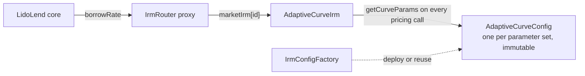
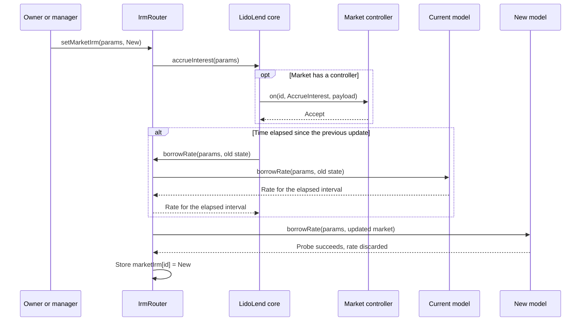

# Interest-rate model

Every standard Lido Lend market stores `IrmRouter` as the `irm` field of its `MarketParams`. The router forwards each pricing call to the model selected for that market. In the standard deployment, every market is routed to one shared `AdaptiveCurveIrm`, configured per market with an immutable `AdaptiveCurveConfig` deployed through `IrmConfigFactory`. This page is for integrators, risk analysts, and auditors.

:::info Source
Based on [`SPECIFICATION.md`](https://github.com/lidofinance/lend-irm/blob/566d31f7dfdf83d07a6593f641f7474c263a7f89/SPECIFICATION.md) and [`FORK_NOTES.md`](https://github.com/lidofinance/lend-irm/blob/566d31f7dfdf83d07a6593f641f7474c263a7f89/FORK_NOTES.md) in `lidofinance/lend-irm` at commit `566d31f`, and on the deployment scripts in [`lidofinance/lend-markets`](https://github.com/lidofinance/lend-markets/blob/main/script/DEPLOYMENT.md) at the mainnet deploy commit. The code at those commits is the final reference.
:::

## Overview

A market cannot change the `irm` field in its `MarketParams`. Router-fronted markets therefore store the router address, and the router keeps the selected model in a separate mapping keyed by market id. This lets governance change the model or its parameters without changing the market id.



| Contract | Deployment | Role in the standard setup |
|---|---|---|
| `IrmRouter` | Behind an `OssifiableProxy` | Stable IRM address in every market. Forwards pricing to the selected model. |
| `AdaptiveCurveIrm` | Direct, non-proxied | The only model that the standard scripts route markets to. Stores per-market `rateAtTarget` and config address. |
| `AdaptiveCurveConfig` | Direct, immutable | One per parameter set. Validates its values in the constructor. |
| `IrmConfigFactory` | Direct, permissionless | Deploys or reuses an `AdaptiveCurveConfig` for an exact parameter set. |

`lidofinance/lend-irm` also contains `LinearKinkIrm`, a non-adapting piecewise-linear model. The standard deployment scripts at the deploy commit do not deploy or route to it. Its behavior is in the [IRM specification](https://github.com/lidofinance/lend-irm/blob/566d31f7dfdf83d07a6593f641f7474c263a7f89/SPECIFICATION.md#linearkinkirm).

### Fork origin

`AdaptiveCurveIrm` forks the Morpho Blue adaptive curve at [`morpho-blue-irm@a1a87fd`](https://github.com/morpho-org/morpho-blue-irm/tree/a1a87fd5a7ee13873ea9d2bbd87e9c7b2cdbbef3). The fork replaces the hardcoded constants with a per-market config, adds owner and manager roles, and adds an optional output cap `maxBorrowRate`. With the upstream parameter values and `maxBorrowRate == 0`, the rate calculation matches upstream. The router, config contracts, and factory are new.

## Market setup

For each market, the deployment and activation flow:

1. builds the final `MarketParams` with `irm` set to the router;
2. gets an `AdaptiveCurveConfig` for the market's curve parameters from `IrmConfigFactory`;
3. calls `applyIrmConfig` on `AdaptiveCurveIrm` with the final `MarketParams` and the config;
4. calls `setMarketIrm` on the router with the same `MarketParams` and `AdaptiveCurveIrm`;
5. has the core owner create the market.

Steps 3 and 4 can run in either order before creation. Routing an uncreated market stores the pointer without calling the model. Market creation then calls `borrowRate` once; creation reverts if that call reverts.

## IrmRouter

`borrowRate(marketParams, market)` checks that the caller is the core (`MORPHO`), loads `marketIrm[id]`, and calls that model's `borrowRate`. `borrowRateView` has no caller check. Both revert with `irm not set` when no route exists. The router uses a normal external call, not `delegatecall`, so each model keeps its own state.

`setMarketIrm(marketParams, newIrm)` is owner-or-manager gated. It rejects a zero address and `MarketParams` whose `irm` is not the router. It does not check bytecode, interface, or rate bounds.

For a live market, `setMarketIrm` runs in a fixed order:



A controller veto or pause, a core accrual failure, or a failing old route blocks migration before the probe. The probe proves only that one call does not revert in the current state.

If the active model later makes elapsed-time accrual revert, `setMarketIrm` cannot switch away, because it calls that failing accrual first. Recovery then needs a repaired or reconfigured model, or a proxy upgrade of the core or router while those proxies are upgradeable.

Neither the router nor the core holds a reentrancy lock while the model runs, so the selected model is trusted code. A malicious model could reenter core accrual and accrue the same interval more than once.

## AdaptiveCurveIrm

`AdaptiveCurveIrm` stores one config address (`marketCurveConfig`) and one adapting `rateAtTarget` per market id. `borrowRate` accepts only the router (`ROUTER`), stores the new `rateAtTarget`, and emits `BorrowRateUpdate`. `borrowRateView` runs the same calculation without saving it.

### Config application

`applyIrmConfig(marketParams, config)` is owner-or-manager gated. It calls `getCurveParams()`, stores the exact config address, clamps a non-zero stored `rateAtTarget` into the new `[minRateAtTarget, maxRateAtTarget]` band, and emits `IrmConfigApplied`. The IRM does not validate the returned values; the included `AdaptiveCurveConfig` validates them in its constructor. Without a config, pricing reverts with `CONFIG_NOT_SET`.

The stored address is a live binding: every pricing call reads `getCurveParams()` again. The standard configs are immutable, so their values cannot change after deployment. A new parameter set needs a new config and a new `applyIrmConfig` call.

`applyIrmConfig` does not accrue the market. If parameters change after time has passed since `lastUpdate`, the next accrual uses the new parameters for the whole interval, including the time before the change.

### Rate calculation

Unsigned utilization division rounds down. Signed WAD operations use:

```text
wMul0(x, y) = truncTowardZero(x * y / WAD)
wDiv0(x, y) = truncTowardZero(x * WAD / y)
```

With `S = totalSupplyAssets`, `B = totalBorrowAssets`, `U* = targetUtilization`, `C = curveSteepness`, `r0` the stored `rateAtTarget`, `a = adjustmentSpeed`, and `T = block.timestamp - market.lastUpdate`:

```text
U = 0                                  if S == 0
U = floor(B * WAD / S)                 otherwise

e = wDiv0(U - U*, U*)                   when U <= U*
e = wDiv0(U - U*, WAD - U*)             when U > U*

coefficient = WAD - wDiv0(WAD, C)        when e < 0
coefficient = C - WAD                    when e >= 0
curve(r, e) = wMul0(WAD + wMul0(coefficient, e), r)
```

For protocol-reachable utilization, `e` is in `[-WAD, WAD]`. Below target, the rate falls toward `rateAtTarget / C` at zero utilization. Above target, it rises toward `C * rateAtTarget` at full utilization.

The target rate adapts over time. On the first state-changing call (`r0 == 0`), it seeds from the config:

```text
averageRateAtTarget = initialRateAtTarget
endRateAtTarget     = initialRateAtTarget
```

Otherwise, with `speed = wMul0(a, e)` and `z = speed * T`, if `z == 0` the stored value is used unchanged. When `z != 0`:

```text
end   = clamp(wMul0(r0, wExp(z)),   minRateAtTarget, maxRateAtTarget)
mid   = clamp(wMul0(r0, wExp(z/2)), minRateAtTarget, maxRateAtTarget)
averageRateAtTarget = (r0 + end + 2 * mid) / 4
endRateAtTarget     = end
```

The raw borrow rate is `curve(averageRateAtTarget, e)`. The returned rate applies the optional cap:

```text
returnedRate = rawBorrowRate                                      if maxBorrowRate == 0
returnedRate = min(rawBorrowRate, maxBorrowRate)                  otherwise
```

Above target utilization the target rate rises over time, and below target it falls, at a speed set by `adjustmentSpeed` and bounded by `[minRateAtTarget, maxRateAtTarget]`. The calculation holds the pre-accrual error `e` fixed for the whole interval, so it can understate the rate when interest raises utilization during that interval. The cap does not change `endRateAtTarget`; when it binds, it lowers accrued interest.

## IrmConfigFactory

`getOrDeployAdaptiveCurveConfig(params)` hashes the ABI-encoded parameters. A cache hit returns the existing config. A miss deploys a new immutable `AdaptiveCurveConfig`, which reverts if the parameters fail validation. `getAdaptiveCurveConfig(params)` returns the cached address or zero. The factory is a deploy-or-reuse cache, not an allowlist: the IRM accepts any ABI-compatible config that an authorized caller applies.

## Parameters

Each market's curve is set by one `AdaptiveCurveConfig`. The bounds below are enforced by the included config constructor.

| Parameter | Meaning | Who can change it | Bounds |
|---|---|---|---|
| `targetUtilization` | Utilization at which the curve equals `rateAtTarget` | Applying a new config (IRM owner or manager) | Above `0`, below `WAD` |
| `curveSteepness` | Ratio between the rate at full utilization and the rate at target | Same | `1 WAD` to `100 WAD` |
| `adjustmentSpeed` | How fast `rateAtTarget` adapts, WAD per second | Same | `0` to `10_000/year` |
| `initialRateAtTarget` | Seed `rateAtTarget` on the first pricing call | Same | Within `[minRateAtTarget, maxRateAtTarget]` |
| `minRateAtTarget` | Lower bound of the adapting target rate | Same | Above `0` |
| `maxRateAtTarget` | Upper bound of the adapting target rate | Same | At least `minRateAtTarget`, at most `10_000/year` |
| `maxBorrowRate` | Cap on the returned rate | Same | `0` (no cap), or at most `100 * (10_000/year)` |
| Route (`marketIrm[id]`) | Model selected for the market | Router owner or manager | Non-zero; live switch must pass accrual and a probe |

Here `x/year` means `floor(x * WAD / 365 days)` per second. These bounds protect the arithmetic. They do not make a parameter set economically suitable.

## Permissions

| Authority | Powers | Initial holder |
|---|---|---|
| Router or IRM owner | Rotate owner and manager, plus all manager operations | Lido DAO Agent |
| `IrmRouter` manager | Route an uncreated market to any non-zero address; switch a live market after accrual and a probe | EVMScriptExecutor |
| `AdaptiveCurveIrm` manager | Apply a compatible config to a market | EVMScriptExecutor |
| Router proxy admin | Replace router logic until ossification | Lido DAO Agent |
| Any account | Deploy a config through `IrmConfigFactory` (does not apply it) | Permissionless |

The router and the IRM have independent owner and manager storage. See [Roles and permissions](../governance/roles-and-permissions).

## Trust assumptions and limitations

- the router owner and manager can route a market to any non-zero address, and the router does not validate the model's rate or future behavior;
- the IRM owner and manager can apply any ABI-compatible config to any market id;
- a routed model runs as trusted code during core accrual, without a reentrancy lock;
- a model that starts reverting blocks accrual, and through it every hooked action and route migration;
- reconfiguration without a prior accrual reprices the unaccrued interval;
- the adaptive calculation holds utilization fixed over each interval and can understate interest;
- the router proxy admin can replace router logic until the proxy is ossified.

## Related

- [Architecture overview](../architecture)
- [Core](./core)
- [Full IRM specification on GitHub](https://github.com/lidofinance/lend-irm/blob/566d31f7dfdf83d07a6593f641f7474c263a7f89/SPECIFICATION.md)
- [IRM fork notes on GitHub](https://github.com/lidofinance/lend-irm/blob/566d31f7dfdf83d07a6593f641f7474c263a7f89/FORK_NOTES.md)
