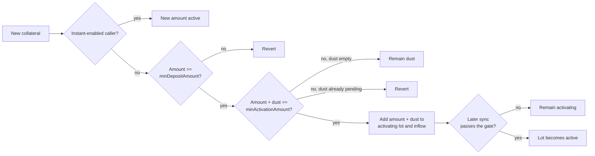

# Market controller

`LidoLendMarketController` is the policy layer for one Lido Lend market. The core stays the source of truth for balances, shares, interest, solvency, and token transfers. The controller keeps its own policy state and either allows a core action or reverts. It cannot change the amounts that the core resolves, and binding it does not let it spend user tokens or act for user accounts.

:::info Source
Based on [`docs/specs/market-controller.md`](https://github.com/lidofinance/lend-markets/blob/main/docs/specs/market-controller.md). The deployed code is the final reference.
:::

## Overview

The controller adds five things to a market:

- a lender supply cap;
- delayed collateral activation and guardian-based borrow gating;
- freeze and pause controls;
- borrower ordering and eligibility for lender settlement;
- a guard against rounding-driven borrow-share inflation.

Settlement policy is on the [Settlement and lender exits](./settlement) page. Guardian identities, reports, bans, and the quorum frontier are on the [Guardian signals](./guardian-signals) page. This page explains how the controller applies both to core actions.

## Policy boundary

A controller accepts hooks only from the `LidoLend` core and only for its bound market. It rejects every hook while paused. Before most hooks, the core accrues interest and converts the request into the exact asset and share amounts that the action will use. Collateral supply skips accrual. An explicit `accrueInterest` call invokes the hook before accrual.

After these shared checks, the controller applies the rules below. The core runs its own accounting, authorization, liquidity, and solvency checks separately.

| Core action | Controller rule |
|---|---|
| Supply loan assets | Enforce the supply cap against accrued supply plus the incoming assets. |
| Withdraw loan assets | None. |
| Borrow | Enforce freeze, bans, active-collateral capacity, and the borrow-share-rate guard. Sync activation and the settlement queue. |
| Repay | Enforce the borrow-share-rate transition guard. Sync the settlement queue. |
| Supply collateral | Sync existing activation, classify the deposit, and update the settlement queue. |
| Withdraw collateral | Enforce freeze, activation, lock, and active-collateral rules. Update the settlement queue. |
| Liquidate | Reduce activation balances and update the settlement queue. The borrow-share-rate guard does not apply. |
| Accrue interest | None. |
| Settle | Enforce the borrow-share-rate transition, bad-debt, eligibility, policy-limit, and lender-tail gates. Reduce activation balances and update the queue. |

An unknown future hook reverts.

### Supply cap

The cap limits new lender supply. Zero means uncapped. A supply is checked against the post-accrual market total plus the incoming assets. Interest can carry the total above the cap. Lowering the cap below the current total removes no supply; it blocks further supply until the total falls below the cap. Withdrawals stay available.

## Borrow capacity

The core tests solvency against the borrower's full collateral. The controller separately tracks which collateral has completed activation. Fresh collateral enters the core at once and protects the position from liquidation, but inactive collateral does not count toward the controller's borrow capacity.

```text
debtAssets = ceil(borrowShares * (totalBorrowAssets + 1)
                                / (totalBorrowShares + 1e6))

collateralValue = floor(activeCollateral * oraclePrice / 1e36)

borrowCapacity = 0                                      when activeCollateral < minActivationAmount
borrowCapacity = floor(collateralValue * LLTV / 1e18)  otherwise
```

Existing debt rounds up, and collateral value and capacity round down. A collateral withdrawal with open debt must leave `debtAssets <= borrowCapacity`. A borrow of exactly `borrowAssets` loan tokens requires:

```text
debtAssets + borrowAssets <= borrowCapacity
```

After the borrow, the core recomputes debt from the updated shares, and rounding can make it slightly higher. For a borrow specified in shares, the difference is at most one raw loan-token unit. For a borrow specified in assets, it can exceed one unit when one borrow share is worth more than one raw unit. Inactive collateral can cover this difference, because the core checks the recomputed debt against the full collateral at the market's LLTV.

A borrow also fails when the caller, the debt owner, or the loan receiver is banned. Guardian strikes and suspect reports extend the debt owner's activation delay when their surcharges are non-zero. Only a ban blocks borrowing directly.

## Collateral activation

The controller splits a borrower's collateral into three balances:

| Balance | Meaning |
|---|---|
| `dust` | Inactive collateral without a timer, from a supply below `minActivationAmount`. At most one unresolved dust lot exists per borrower. |
| `activating` | Inactive collateral in the activation timer. While an activation lock applies, it cannot be withdrawn voluntarily. |
| `active` | The rest of the core collateral. It counts toward borrow capacity only when the total active amount reaches `minActivationAmount`. |

Only `dust` and `activating` are stored:

```text
active = core collateral - dust - activating
```

All activating collateral of one borrower shares one start time and one stored base delay. This is the borrower's **activating lot**.



### Classifying a collateral supply

A collateral-supply hook first syncs any existing lot, then classifies the new amount:

1. a normal supply below `minDepositAmount` reverts, and a zero `minDepositAmount` disables this floor;
2. if dust is pending, a normal supply must lift `dust + amount` to `minActivationAmount`, or it reverts;
3. a combined amount below `minActivationAmount` stays as dust and does not start a timer;
4. a combined amount at or above the threshold moves to `activating` and is added to market inflow.

Anyone can supply collateral for a borrower. A third party's dust supply therefore forces the borrower's next normal supply to resolve it. The borrower is not trapped: the dust stays withdrawable in full under the withdrawal rules below, and sizing the next supply to `minActivationAmount - dust` always resolves it.

A normal top-up that reaches the threshold joins the existing lot. It replaces the lot's start and base delay only when its new deadline is later, so a top-up can postpone activation but never bring it forward.

### Instant activation

A supply through an instant-enabled caller bypasses the floor, dust, the timer, and the inflow throttle. A small instant supply is active but gives no borrow capacity until total active collateral reaches `minActivationAmount`.

Instant activation is keyed by the call's sender, not the collateral owner. The controller does not check that an enabled address restricts access. A permissionless helper with instant activation would let any user bypass activation, so each enabled caller must enforce its own routing policy. No caller is enabled initially.

### Base delay and market inflow

The base delay depends on recent non-instant collateral inflow across the whole market. For a threshold-crossing supply, `effectiveInflow` includes the new amount and any dust released into it:

```text
baseDelay = minActivationDelay
          + floor((maxActivationDelay - minActivationDelay)
                  * effectiveInflow / maxDelayInflow)

baseDelay = maxActivationDelay when effectiveInflow >= maxDelayInflow
```

Before a new contribution, stored inflow decays, where `elapsed` is the time since the inflow snapshot was last updated:

```text
decay = floor(maxDelayInflow * elapsed / maxActivationDelay)
decayedInflow = max(storedInflow - decay, 0)
```

Splitting a deposit across addresses does not reset this market-wide accumulator. A lot keeps the base delay quoted when it starts or when a top-up extends its deadline. If the same borrower's collateral is withdrawn, liquidated, or settled in the same transaction, the controller subtracts at most that borrower's recorded contribution, so an add-then-remove sequence does not inflate later delays.

The decay always uses the current configuration, so changing `maxDelayInflow` or `maxActivationDelay` reinterprets the existing snapshot.

### Maturation gate

Activation is lazy. Collateral-supply, collateral-withdrawal, and borrow hooks try to mature an existing lot. Time alone does not update balances.

At each sync, the controller reads the borrower's ban, strike count, suspect snapshot, and the quorum frontier from [`GuardianSignals`](./guardian-signals):

```text
unlockTime = activatingStart + storedBaseDelay
           + strikeCount * delayPerStrike
           + suspectCount * delayPerSuspect
             when activatingStart < suspectExpiryTimestamp
```

A banned borrower has no finite unlock time. Otherwise the lot matures only when all three conditions hold:

1. `block.timestamp >= unlockTime`;
2. the quorum frontier has reached `unlockTime`, or `block.timestamp >= activatingStart + maxGuardiansQuorumDelay`;
3. the market is not frozen.

Setting `maxGuardiansQuorumDelay` to zero removes the frontier wait, not the activation delay. Freeze does not change the deadline; an otherwise ready lot can mature on the first sync after unfreeze.

:::note
The quorum-delay fallback lets a lot mature without new guardian frontier progress. This is an accepted liveness trade-off. See [Guardian signals](./guardian-signals#heartbeats-and-the-quorum-frontier).
:::

### Withdrawals and forced reductions

A voluntary collateral withdrawal first runs the maturation sync. If the borrower then has no inactive collateral, the withdrawal uses active collateral only, subject to freeze, health, and core checks. Otherwise the inactive balance (dust plus the activating lot) leaves all at once or not at all:

1. while the lot is inside `activatingLockDuration` from its start, a withdrawal within the active balance passes and leaves the inactive buckets untouched, and anything larger reverts;
2. after the lock window, or with the lock disabled, the requested amount must cover the whole inactive balance. The withdrawal then clears both buckets, stops the timer, and takes any remainder from active.

The lock binds only while the position holds a non-zero activating balance. With open debt, the post-withdrawal health check counts only the remaining active balance.

Liquidation and settlement are forced reductions. They do not mature the lot first and ignore the lock. They consume active collateral, then dust, then activating. A remaining activating balance keeps its start and base delay. Activation policy never limits the size of a forced reduction.

### Configuration changes

Configuration changes do not move collateral between buckets. A lot keeps its start and base delay. Current values govern the minimum amount, the withdrawal lock, guardian surcharges, the quorum fallback, and inflow decay, so changes can affect existing positions at once.

## Freeze and pause

| State | Blocks | Still permits |
|---|---|---|
| Freeze | Borrowing; collateral withdrawal while debt remains; maturation from activating to active. | Loan-asset supply and withdrawal, collateral supply, repay, liquidation, settlement, and debt-free collateral withdrawal subject to the activation lock. |
| Pause | Every core action that calls the controller, including repayment, liquidation, settlement, and explicit interest accrual. | Core calls without a market hook, such as flash loans and authorization changes; ERC-4626 vault-share transfers; controller administration. |

Freeze keeps debt reduction and lender exits available. Pause is for incidents in which liquidation or settlement is unsafe. Pause does not stop the interest clock: the next successful accrual covers the paused time.

`freeze()` freezes the market, and `unfreeze()` lifts the freeze. Market stewards freeze through `RiskStewardDashboard`. The dashboard can only tighten activation rules, revoke instant activation, and freeze; it cannot loosen rules or unfreeze.

`pauseFor(duration)` pauses the controller, and `resume()` ends the pause. A `duration` of `PAUSE_INFINITELY` gives an indefinite pause. A finite pause expires on its own. [`CircuitBreaker`](/contracts/circuit-breaker) lets a registered emergency actor trigger one finite pause per registration. In Lido Lend, this actor is the [Lend Emergency Brakes Committee](../governance/committees#lend-emergency-brakes-committee), which the `ActivateMarket` motion registers for the new market's controller.

The Lido Lend [`CircuitBreaker`](../deployed-contracts#circuit-breaker) instance was deployed with these settings:

| Setting | Value |
|---|---|
| `MIN_PAUSE_DURATION` | 432,000 seconds (5 days) |
| `MAX_PAUSE_DURATION` | 5,184,000 seconds (60 days) |
| `pauseDuration` | 1,814,400 seconds (21 days) |
| `heartbeatInterval` | 31,536,000 seconds (365 days) |

The duration bounds are immutable. The `CircuitBreaker` admin, the Easy Track `EVMScriptExecutor`, can change `pauseDuration` within these bounds.

## Borrow-share-rate transition guard

Near an empty debt book, repayment can reduce `totalBorrowAssets` to zero while some `totalBorrowShares` remain. A small later borrow can then mint a very large number of shares. Repeating this cycle could overflow the `uint128` share total and stop new debt from being recorded. The guard limits this:

```text
totalBorrowShares + 1e6 <= 1e7 * (totalBorrowAssets + 1)
```

The natural empty-market ratio is `1e6` virtual shares per raw loan-asset unit. The guard allows up to ten times that ratio (`MAX_BORROW_SHARE_RATE = 1e7`). It is a transition guard, not a permanent invariant:

- every borrow must leave the market within the ceiling, and a share-based borrow that resolves to zero assets reverts;
- repay and settlement cannot move a market from at or below the ceiling to above it;
- when the market already starts above the ceiling, repay and settlement stay available for cleanup;
- liquidation is exempt.

If accrual leaves the market above the ceiling, every borrow reverts. When the asset total is zero, an exact-share repayment can remove the remaining shares.

## Parameters

The bounds below are enforced by the controller code.

| Parameter | Meaning | Who can change it | Bounds |
|---|---|---|---|
| `supplyCap` | Lender supply admission limit in loan-token units | `MANAGER_ROLE` | `0` means uncapped |
| `minActivationDelay` | Base delay at zero inflow | `MANAGER_ROLE`; stewards can only increase | Above zero, at most `maxActivationDelay` |
| `maxActivationDelay` | Base delay at or above `maxDelayInflow` | `MANAGER_ROLE`; stewards can only increase | At most 7 days |
| `maxDelayInflow` | Inflow, in raw collateral units, that gives the maximum delay | `MANAGER_ROLE` | Above zero |
| `minDepositAmount` | Floor for a normal collateral supply | `MANAGER_ROLE`; stewards can only increase | At most `minActivationAmount`; `0` disables |
| `minActivationAmount` | Dust threshold and minimum active amount for borrow capacity | `MANAGER_ROLE` | Above zero |
| `activatingLockDuration` | Window from lot start in which inactive collateral cannot leave | `MANAGER_ROLE`; stewards can only increase | At most 7 days; `0` disables |
| `maxGuardiansQuorumDelay` | Fallback deadline from lot start for the frontier gate | `MANAGER_ROLE`; stewards can only increase | `0`, or above `maxActivationDelay` and at most 7 days |
| `delayPerStrike` | Extra delay per guardian flag | `MANAGER_ROLE` | At most 7 days |
| `delayPerSuspect` | Extra delay per live suspect report | `MANAGER_ROLE` | At most 7 days |
| Instant-activation callers | Addresses whose collateral supplies activate at once | `MANAGER_ROLE` enables; stewards can revoke | None initially |
| `MAX_BORROW_SHARE_RATE` | Borrow-share-rate ceiling | Fixed in code | `1e7` |

Settlement parameters are on the [Settlement and lender exits](./settlement#parameters) page.

## Permissions

| Role | Powers | Initial holder |
|---|---|---|
| `DEFAULT_ADMIN_ROLE` | Grant and revoke controller roles | Lido DAO Agent |
| `MANAGER_ROLE` | Set collateral-activation config, settlement config, supply cap, and instant-activation callers | `LidoLendOwner` and `RiskStewardDashboard` |
| `FREEZER_ROLE` | Freeze the market | `RiskStewardDashboard` |
| `UNFREEZER_ROLE` | Unfreeze the market | `LidoLendOwner` |
| `PAUSER_ROLE` | Pause all controller hooks for a chosen duration, including indefinitely | `CircuitBreaker` and Reseal Manager |
| `RESUMER_ROLE` | End a pause early | Reseal Manager |

`RiskStewardDashboard` holds the broad `MANAGER_ROLE`, but its non-upgradeable code exposes only tightening, instant-activation revocation, and freeze. The controller is deployed behind an `OssifiableProxy` whose admin is the Lido DAO Agent. See [Roles and permissions](../governance/roles-and-permissions).

## Trust assumptions and limitations

- a faulty or paused controller can block every hooked action in its market, including repayment and withdrawal;
- instant-activation callers bypass activation entirely, so each one must enforce its own access policy;
- the quorum-delay fallback lets collateral activate without new guardian scan evidence after the deadline;
- after an assets-based borrow, rounding can make debt exceed active-collateral capacity by more than one raw unit, covered by inactive collateral;
- a third party can front-run a borrower's collateral supply with dust and force the next supply to resolve it;
- configuration changes apply to existing positions immediately;
- the controller's proxy admin can replace its code until the proxy is ossified.

## Related

- [Architecture overview](../architecture)
- [Guardian signals](./guardian-signals)
- [Settlement and lender exits](./settlement)
- [Full market controller specification on GitHub](https://github.com/lidofinance/lend-markets/blob/main/docs/specs/market-controller.md)
- [Privileged roles specification on GitHub](https://github.com/lidofinance/lend-markets/blob/main/docs/specs/roles.md)
