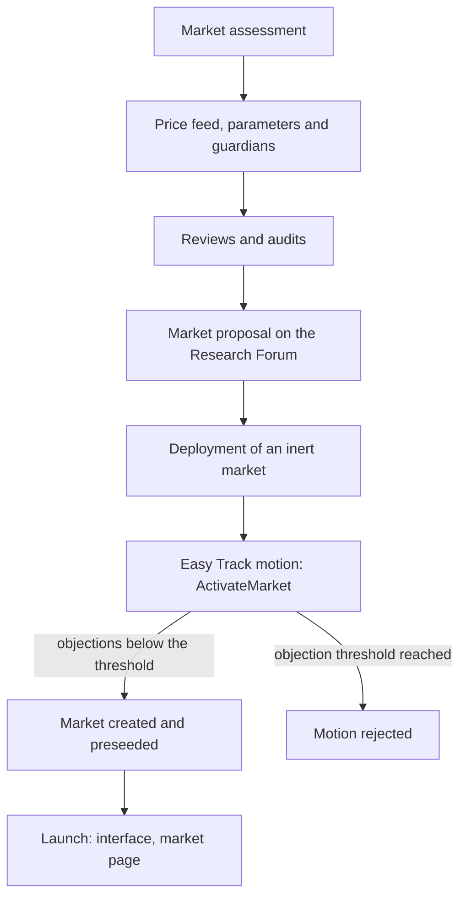

# Market onboarding

This page is for governance participants, asset issuers and curators. It describes how a new market goes from an idea to a live market.

Markets are added one at a time. Lido contributors prepare each market and publish its parameters in the Lido Lend thread on the [Lido Research Forum](https://research.lido.fi/t/unveiling-lido-lend-security-first-lending/11987). The [Lend Operational Committee](./committees#lend-operational-committee) then starts an Easy Track motion to activate the market, and LDO holders can object to it. A market normally needs no separate Lido DAO vote. The DAO vote that registers the Lido Lend Easy Track factories does not approve specific markets. It sets the actions that a motion can perform. Actions outside these factories need a Lido DAO vote.

Each stage publishes its results in two places:

- **the forum thread:** the [Lido Lend Research Forum thread](https://research.lido.fi/t/unveiling-lido-lend-security-first-lending/11987);
- **the market page:** a separate page for each market in these docs, with everything specific to that market: deployed contracts, guardians, parameters and audits.

## Process overview

Some stages can run in parallel. Deployment does not depend on the motion, but the market must be deployed and verified before the motion starts.

## Market assessment

**What happens:** Lido contributors decide whether the market fits Lido Lend. They check that the loan and collateral tokens work with the Lido Lend mechanics, such as liquidation and settlement. They also check which existing components the market can reuse. Each market is assessed separately.

**Who is responsible:** Lido contributors.

**Public output:** none.

## Price feed, parameters and guardians

**What happens:** Lido contributors define how the collateral is priced, choose the market parameters, and set up the guardians for the market. The parameters are:

- the five market parameters: loan token, collateral token, oracle, IRM and LLTV;
- the supply cap;
- the collateral activation config;
- the settlement config and settlement enablement;
- the Adaptive Curve IRM configuration;
- the market fee;
- instant-activation callers, if any.

The oracle and LLTV are part of the market id, so they cannot change after the market is created. The controller address and settlement enablement are fixed at creation too. The guardian setup decides whether the market uses a new `GuardianSignals` registry or shares an existing one. A shared registry shares its guardian set, quorum and suspect window with every market that uses it. See [Interest rate model](../architecture/interest-rate-model), [Settlement](../architecture/settlement) and [Guardian signals](../architecture/guardian-signals).

**Who is responsible:** Lido contributors and the guardian operators.

**Public output:** market parameters and guardians, on the market page.

## Reviews and audits

**What happens:** Contract code that is new for the market, such as a new price feed, is reviewed and audited before deployment.

**Who is responsible:** Lido contributors and external auditors.

**Public output:** audit reports, on the market page.

## Market proposal on the Research Forum

**What happens:** Lido contributors publish the market in the Lido Lend Research Forum thread before the motion. The community uses the post to decide whether to object. The post includes:

- the five market parameters;
- the supply cap, the collateral activation and settlement configuration, and the IRM configuration;
- the Guardian Security Council membership and quorum for the market.

**Who is responsible:** Lido contributors.

**Public output:** market proposal, in the [forum thread](https://research.lido.fi/t/unveiling-lido-lend-security-first-lending/11987).

## Deployment

**What happens:** The price feed, the `GuardianSignals` registry (if the market needs a new one) and the market contracts are deployed in an inert state. The market controller and vault are deployed through the permissionless `LidoLendMarketFactory`. The deployment gives the caller no role, and nobody can use the market until the activation motion creates it in the core. The deployment is then verified on Etherscan and against the audited code.

**Who is responsible:** Lido contributors.

**Public output:** contract addresses and verification results, in the [forum thread](https://research.lido.fi/t/unveiling-lido-lend-security-first-lending/11987) and on the market page.

## Activation

**What happens:** The Lend Operational Committee starts an `ActivateMarket` motion. LDO holders can object during the motion period. If the objection threshold is not reached, anyone can enact the motion, and the market is created.

**Who is responsible:** Lend Operational Committee. LDO holders can object.

**Public output:** link to the Easy Track motion, in the [forum thread](https://research.lido.fi/t/unveiling-lido-lend-security-first-lending/11987).

## Launch

**What happens:** The market appears in the Lido Lend interface, and its market page is published.

**Who is responsible:** Lido contributors.

**Public output:** the market in the Lido Lend interface, and the market page.

## Activation on-chain

The `LidoLendActivateMarket` Easy Track factory builds the activation motion. Only the Lend Operational Committee, the factory's trusted caller, can create it. For how motions, objections and enactment work, see the [Easy Track guide](/guides/easy-track-guide).

When the motion is enacted, the `EVMScriptExecutor` makes these calls in one transaction:

1. `AdaptiveCurveIrm.applyIrmConfig`: applies the market's IRM configuration;
2. `IrmRouter.setMarketIrm`: routes the market to `AdaptiveCurveIrm`;
3. `LidoLendOwner.createMarket`: creates the market in the core with its controller and settlement setting;
4. `RiskStewardDashboard.addMarketSteward`: appoints the market steward;
5. `CircuitBreaker.registerPauser`: registers the Circuit Breaker pauser for the market controller;
6. `LidoLendPreseeder.preseedMarket`: supplies loan tokens to the new market and its vault and locks the minted shares permanently;
7. `LidoLendOwner.setFee`: sets the market fee, only when the fee is not zero.

Before the motion starts, the factory checks the inputs. The motion cannot be created if:

- the loan token, collateral token, oracle, IRM config, controller, steward or pauser is the zero address;
- the LLTV is 100% or higher, or the fee is above 25%;
- the market's `irm` is not the `IrmRouter`;
- a market with the same parameters already exists;
- `LidoLendPreseeder` cannot preseed the market and vault, for example because it does not hold enough loan tokens;
- the controller or the vault does not match what `LidoLendMarketFactory` expects for this market.

The preseed uses loan tokens that are sent to `LidoLendPreseeder` before the motion. The Lido DAO Agent can recover tokens that the preseeder holds but has not spent. It cannot recover the locked shares.

After activation, market settings change through the other Lido Lend Easy Track motions, such as `SetSupplyCap`, `SetCollateralActivationConfig` or `ApplyIrmConfig`. A change outside the factories, such as a new IRM route for a live market or a role grant, needs a Lido DAO vote. See [Roles and permissions](./roles-and-permissions#easy-track-motions) for the full list of motions.

Factory source: [`LidoLendActivateMarket.sol`](https://github.com/lidofinance/easy-track/blob/4caa9117435631ef352d263c901fa9e26cfccfb4/contracts/EVMScriptFactories/lidoLendFactories/LidoLendActivateMarket.sol) in `lidofinance/easy-track`.
