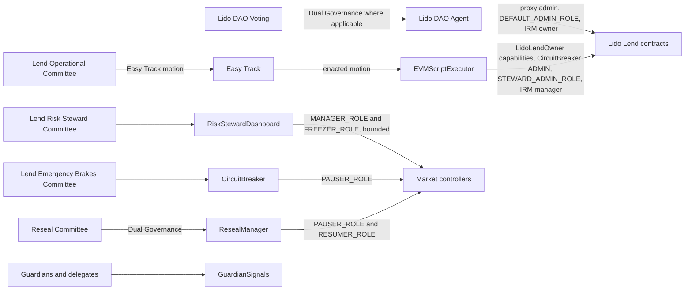

# Roles and permissions

This page is for governance participants, auditors and integrators. It lists every privileged role in the Lido Lend contracts, the functions each role gates, and the initial holder of each role after the production deployment.

Lido Lend has no single administrator. Powers are split between four governance routes:

- the Lido DAO, through the Lido DAO Agent, holds upgrades, role administration and actions outside the routine set;
- the Easy Track route, through the `EVMScriptExecutor`, holds routine configuration. It executes only motions built by registered Lido Lend factories;
- committees with narrow, instant powers act through `RiskStewardDashboard` and [`CircuitBreaker`](/contracts/circuit-breaker);
- the Dual Governance `ResealManager` can extend or end a controller pause.

The contracts see addresses, not the governance process behind them. This page names the initial on-chain holder of each role. [Committees](./committees) describes the committees that operate the committee addresses.

The full specification is [`docs/specs/roles.md`](https://github.com/lidofinance/lend-markets/blob/main/docs/specs/roles.md) in `lidofinance/lend-markets`.

## Governance routes

| Route | Executor on-chain | What it is used for |
| --- | --- | --- |
| Lido DAO vote | Lido DAO Agent | Contract upgrades, role administration, ownership transfers, changes of a live market's IRM route, revenue settings and asset recovery |
| Easy Track motion | `EVMScriptExecutor` | Market activation and the routine configuration actions listed in [Easy Track motions](#easy-track-motions) |
| Committee multisig | Committee Safe | Instant, bounded actions: tighten or freeze a market, apply one finite controller pause |
| Dual Governance reseal | `ResealManager` | Keep an already paused controller paused during a governance emergency, or resume it |
| Guardian reports | Guardian or its delegate | Account risk signals and collateral-screening heartbeats in `GuardianSignals` |

An Easy Track motion executes through the `EVMScriptExecutor`. The executor holds broad capabilities, but a motion can only make the calls that a registered factory builds. The factory set registered by the Lido DAO vote therefore sets the real limits of the Easy Track route. See [Market onboarding](./market-onboarding) for how motions are used.

## Impact classification

Each action has an impact class. Impact classes are design labels from the specification. The contracts do not enforce them. A role can have more than one class when tightening and loosening the same parameter have different effects.

| Class | Effect | Intended authority |
| --- | --- | --- |
| C0 | Take, burn, redirect, confiscate, or permanently prevent recovery of user value | Not allowed as an operational action |
| C1 | Upgrade logic, administer privileged roles, or introduce a C0 power | Lido DAO governance |
| C2 | Temporarily stop controller-hooked actions | CircuitBreaker-operated emergency actor |
| C3 | Reduce risk or deny new service | Bounded security or risk-steward path |
| C4 | Increase risk, restore service, or scale exposure | Lido DAO governance or an approved delayed path |
| C5 | Metadata or UI-only impact | Bounded operator |

Except for proxy administration, no role listed below can directly rewrite or redirect a core or vault position. Proxy administration can change this guarantee until the relevant proxy is ossified.

## Roles by contract

The holders below are the initial topology created by the production deployment scripts. The deployer uses temporary setup roles and revokes them before the deployment script returns. Calling the permissionless `LidoLendMarketFactory` gives the caller no role.

For addresses of the Lido DAO Agent, `EVMScriptExecutor`, `ResealManager` and the Lido Lend contracts, see [Deployed contracts](../deployed-contracts). For committee addresses, see [Committees](./committees).

### LidoLendOwner

`LidoLendOwner` is a direct, non-upgradeable facade. It is the owner of the `LidoLend` core. It gates the core-owner calls and forwards controller and `GuardianSignals` calls through separate capability roles. One core, and so one `LidoLendOwner`, serves all markets of a deployment.

| Role | Can do | Impact class | Intended holder |
| --- | --- | --- | --- |
| `MARKET_CREATOR_ROLE` | Create controller-less or controlled markets (`createMarket`). Fixes the controller and settlement enablement at creation | C4 / C1 | `EVMScriptExecutor` |
| `FEE_MANAGER_ROLE` | Set a market fee up to the core's 25% cap (`setFee`). Set the core-wide fee recipient (`setFeeRecipient`) | C3 / C4 | `EVMScriptExecutor` |
| `MARKET_MANAGER_ROLE` | Set the supply cap, collateral activation config, settlement config and instant-activation callers (`setMarketSupplyCap`, `setMarketCollateralActivationConfig`, `setMarketSettlementConfig`, `setInstantActivation`). Unfreeze a market (`unfreezeMarket`) | C3 / C4 | `EVMScriptExecutor` |
| `GUARDIAN_MANAGER_ROLE` | Change a registry's guardians, quorum and suspect window (`addGuardian`, `replaceGuardian`, `removeGuardian`, `setGuardiansQuorum`, `setGuardiansSuspectWindow`). Clear a ban for selected market ids (`unbanGuardianSignals`) | C1 / C3 / C4 | `EVMScriptExecutor` |
| `DEFAULT_ADMIN_ROLE` | Administer the facade roles. Transfer core ownership while the facade is the core owner (`transferLidoLendOwnership`) | C1 | Lido DAO Agent |

Controller and `GuardianSignals` calls pass two checks: the caller must hold the facade capability, and the facade must hold the downstream role on the target contract. The `EVMScriptExecutor` holds the facade capabilities but no controller or `GuardianSignals` role directly.

Before ownership moves to the facade, the deployment sets the core-wide fee recipient to the Lido DAO Agent. If core ownership is transferred away, the facade loses its core-owner calls but keeps its controller and `GuardianSignals` roles until governance revokes them.

Guardian roster, quorum and suspect-window changes apply to the whole registry and therefore to every market that shares it. `unbanGuardianSignals` stays keyed by market id.

Neither the facade nor the core requires factory-produced components or the standard `IrmRouter`. `MARKET_CREATOR_ROLE` can therefore create a market outside the standard topology. The `LidoLendActivateMarket` Easy Track factory checks the IRM route, the controller and the vault before a motion starts.

### LidoLendMarketController

Each market has its own `LidoLendMarketController`. See [Market controller](../architecture/market-controller) for what freeze and pause do to user actions.

| Role | Can do | Impact class | Intended holder |
| --- | --- | --- | --- |
| `DEFAULT_ADMIN_ROLE` | Grant and revoke controller roles | C1 | Lido DAO Agent |
| `MANAGER_ROLE` | Set the collateral activation config, settlement config, supply cap and instant-activation callers (`setCollateralActivationConfig`, `setSettlementConfig`, `setSupplyCap`, `setInstantActivation`) | C3 / C4 | `LidoLendOwner` and `RiskStewardDashboard` |
| `FREEZER_ROLE` | Freeze the market (`freeze`) | C3 | `RiskStewardDashboard` |
| `UNFREEZER_ROLE` | Unfreeze the market (`unfreeze`) | C4 | `LidoLendOwner` |
| `PAUSER_ROLE` | Pause all controller hooks for a selected duration, including indefinitely (`pauseFor`) | C2 / C3 | `CircuitBreaker` and `ResealManager` |
| `RESUMER_ROLE` | End a controller pause early (`resume`) | C4 | `ResealManager` |
| Instant-activation caller | Collateral supplied through this caller becomes active immediately. It bypasses dust, the activation delay and inflow throttling | C4 | None initially |

`LidoLendOwner` exposes the full manager surface to its capability holder. `RiskStewardDashboard` holds the same `MANAGER_ROLE`, but its code exposes only bounded tightening, instant-activation revocation and freeze.

The roles are granted before market creation. `LidoLendOwner` and `RiskStewardDashboard` can reach the controller only after market activation binds it in the core. The initial topology has one unfreeze path, through `LidoLendOwner`. A `CircuitBreaker` pause normally ends when its duration expires. The `ResealManager` can extend the pause or end it early. As controller admin, the Lido DAO Agent can change any of these assignments later.

### RiskStewardDashboard

One direct, non-upgradeable `RiskStewardDashboard` serves the markets of one core. Steward membership is stored separately for each market id. A steward acts only through the dashboard. The dashboard, not the steward, holds the controller roles.

| Role | Can do | Impact class | Intended holder |
| --- | --- | --- | --- |
| `DEFAULT_ADMIN_ROLE` | Administer dashboard roles | C1 | Lido DAO Agent |
| `STEWARD_ADMIN_ROLE` | Add or remove a steward for a market (`addMarketSteward`, `removeMarketSteward`) | C3 | `EVMScriptExecutor` |
| Per-market steward | Increase collateral activation delays, the activating lock and the single-deposit floor (`increaseActivationDelays`, `increaseActivatingLockDuration`, `increaseMinDepositAmount`). Revoke instant activation (`revokeInstantActivation`). Freeze the market (`freezeMarket`) | C3 | None initially. The `ActivateMarket` motion appoints the selected steward |

Each `increase*` function reverts if the new value is lower than the current one. A steward cannot loosen settings or unfreeze a market.

### GuardianSignals

A `GuardianSignals` registry can serve one or several markets. See [Guardian signals](../architecture/guardian-signals) for how flags, suspects and heartbeats work.

| Role | Can do | Impact class | Intended holder |
| --- | --- | --- | --- |
| `DEFAULT_ADMIN_ROLE` | Grant and revoke registry roles | C1 | Lido DAO Agent |
| `MANAGER_ROLE` | Change the guardian set, quorum and suspect window (`addGuardian`, `replaceGuardian`, `removeGuardian`, `setQuorum`, `setSuspectWindow`) | C1 / C3 / C4 | `LidoLendOwner` |
| `ACCESS_LIMITER_ROLE` | Ban one account in one market without guardian quorum (`ban`) | C3 | No initial holder |
| `ACCESS_RESTORER_ROLE` | Clear a ban for one account in one market (`unban`) | C4 | `LidoLendOwner` |

Guardians and their delegates are privileged actors, but they do not hold AccessControl roles. A guardian controls its current delegate. Delegate addresses can therefore change, and the deployment acceptance checks do not pin them.

| Actor | Can do | Impact class | Intended holder |
| --- | --- | --- | --- |
| Guardian | Appoint, replace or clear its delegate (`setDelegate`). Report signals and heartbeat progress under its own identity (`flag`, `unflag`, `suspect`, `unsuspect`, `heartbeat`) | C1 / C3 / C4 | Configured guardian set |
| Current guardian delegate | Report signals and heartbeat progress under the guardian's identity | C3 / C4 | None until a guardian appoints one |

### CircuitBreaker

The production deployment uses one [`CircuitBreaker`](/contracts/circuit-breaker) instance for all Lido Lend controllers. It is a separate instance from the `CircuitBreaker` that serves the Lido core protocol. Its `ADMIN` is immutable.

The specification gives no impact class for these two authorities.

| Authority | Can do | Intended holder |
| --- | --- | --- |
| `ADMIN` | Change the instance-wide pause duration and heartbeat interval within immutable bounds (`setPauseDuration`, `setHeartbeatInterval`). Register, replace or remove the pauser for any target (`registerPauser`) | `EVMScriptExecutor` |
| Registered controller pauser | Keep a live heartbeat (`heartbeat`). Trigger one finite pause of a registered controller (`pause`) | None after component deployment. The `ActivateMarket` motion registers the selected pauser |

A successful pause consumes the pauser's registration for that controller. The pauser cannot configure `CircuitBreaker` or resume the controller. The admin cannot exceed the immutable duration bounds and cannot pause a controller through `CircuitBreaker` without a live registration.

### Interest rate models

In a standard market, the immutable `irm` field points to `IrmRouter`. The router selects a model for each market. `AdaptiveCurveIrm` is the standard model. `LinearKinkIrm` is optional. See [Interest rate model](../architecture/interest-rate-model).

| Authority | Can do | Impact class | Intended holder |
| --- | --- | --- | --- |
| Router or IRM `owner` | Transfer ownership and replace the manager (`transferOwnership`, `setManager`). Use the manager operations below | C1 / C4 | Lido DAO Agent |
| `IrmRouter` `manager` | Route an uncreated market to any nonzero address, with no allowlist or interface check. A live route must pass one `borrowRate` call (`setMarketIrm`) | C4 | `EVMScriptExecutor` |
| Adaptive or Linear IRM `manager` | Apply a compatible configuration contract to a market (`applyIrmConfig`) | C3 / C4 | `EVMScriptExecutor` |

`IrmConfigFactory` deploys immutable configs without permission and holds no role. Neither model requires a config to come from that factory. `AdaptiveCurveIrm` reads the selected config again on each rate calculation, so a compatible mutable config can change its parameters without another manager call.

## Easy Track motions

The Lend Operational Committee is the trusted caller of the Lido Lend Easy Track factories. Each factory builds an EVM script with a fixed set of target contracts and functions. The factory checks the inputs before the motion starts. Source: [`lidofinance/easy-track`, `contracts/EVMScriptFactories/lidoLendFactories`](https://github.com/lidofinance/easy-track/tree/4caa9117435631ef352d263c901fa9e26cfccfb4/contracts/EVMScriptFactories/lidoLendFactories).

The table shows the factory source at commit `4caa911`. Only the factories that the Lido DAO vote registers in Easy Track can be used. See [Market onboarding](./market-onboarding) for the status of the vote.

| Factory | Action | Calls |
| --- | --- | --- |
| `LidoLendActivateMarket` | Activate a deployed market | `AdaptiveCurveIrm.applyIrmConfig`, `IrmRouter.setMarketIrm`, `LidoLendOwner.createMarket`, `RiskStewardDashboard.addMarketSteward`, `CircuitBreaker.registerPauser`, `LidoLendPreseeder.preseedMarket`, and `LidoLendOwner.setFee` when the fee is not zero |
| `LidoLendMarketManagerActions` | `SetInstantActivation` | `LidoLendOwner.setInstantActivation` |
| `LidoLendMarketManagerActions` | `SetCollateralActivationConfig` | `LidoLendOwner.setMarketCollateralActivationConfig` |
| `LidoLendMarketManagerActions` | `SetSettlementConfig` | `LidoLendOwner.setMarketSettlementConfig` |
| `LidoLendMarketManagerActions` | `SetSupplyCap` | `LidoLendOwner.setMarketSupplyCap` |
| `LidoLendMarketManagerActions` | `UnfreezeMarkets` | `LidoLendOwner.unfreezeMarket` for each market |
| `LidoLendMarketManagerActions` | `SetFee` | `LidoLendOwner.setFee` |
| `LidoLendGuardianActions` | `AddGuardian` | `LidoLendOwner.addGuardian`, then `LidoLendOwner.setGuardiansQuorum` |
| `LidoLendGuardianActions` | `RemoveGuardian` | `LidoLendOwner.setGuardiansQuorum`, then `LidoLendOwner.removeGuardian` |
| `LidoLendGuardianActions` | `ReplaceGuardian` | `LidoLendOwner.replaceGuardian` |
| `LidoLendGuardianActions` | `SetGuardiansQuorum` | `LidoLendOwner.setGuardiansQuorum` |
| `LidoLendGuardianActions` | `SetSuspectWindow` | `LidoLendOwner.setGuardiansSuspectWindow` |
| `LidoLendGuardianActions` | `UnbanAccounts` | `LidoLendOwner.unbanGuardianSignals` for each request |
| `LidoLendRiskStewardActions` | `AddRiskSteward` | `RiskStewardDashboard.addMarketSteward` |
| `LidoLendRiskStewardActions` | `RemoveRiskSteward` | `RiskStewardDashboard.removeMarketSteward` |
| `LidoLendCircuitBreakerActions` | `RegisterPauser` | `CircuitBreaker.registerPauser`. The zero address removes the pauser |
| `LidoLendCircuitBreakerActions` | `SetPauseDuration` | `CircuitBreaker.setPauseDuration`, within the immutable bounds |
| `LidoLendCircuitBreakerActions` | `SetHeartbeatInterval` | `CircuitBreaker.setHeartbeatInterval`, within the immutable bounds |
| `LidoLendApplyIrmConfig` | Apply a new IRM config | `LidoLend.accrueInterest`, then `AdaptiveCurveIrm.applyIrmConfig`. Reverts if the market is paused or its route is not `AdaptiveCurveIrm` |

No factory upgrades contracts, administers roles, changes the core fee recipient, changes the IRM route of a live market, withdraws user positions, or starts settlement. These actions follow the Lido DAO route. When the Lido DAO Agent does not hold the required role, the vote must use an authorized caller or grant the role first.

## Proxy administration

The Lido DAO Agent is the initial proxy admin of the shared core and `IrmRouter`, and of every factory-deployed controller, vault and `GuardianSignals` registry. A shared `GuardianSignals` registry has one proxy admin even when several markets use it.

| Authority | Can do | Impact class | Intended holder |
| --- | --- | --- | --- |
| `OssifiableProxy` admin | Replace the implementation (`proxy__upgradeTo`, `proxy__upgradeToAndCall`), transfer proxy administration (`proxy__changeAdmin`), or irreversibly set the admin to `address(0)` (`proxy__ossify`) | C1 | Lido DAO Agent |

Proxy administration is independent of the implementation roles and can change their guarantees. Ossification is per proxy and leaves ownership and role-based powers in place.

The following contracts are direct deployments, not proxies: `LidoLendOwner`, `RiskStewardDashboard`, `AdaptiveCurveIrm`, the optional `LinearKinkIrm`, `IrmConfigFactory`, `LidoLendMarketFactory` and `CircuitBreaker`.

## Verification

The deployment acceptance checks compare the live state with this topology. They check the exact holder set of every AccessControl role on this page and reject missing or extra holders. They also check proxy admins, core ownership, and the owner and manager of `IrmRouter` and `AdaptiveCurveIrm`.

At deployment, the deployer, the Lido DAO Agent and the `EVMScriptExecutor` must be different addresses. These checks do not cover guardians, stewards, delegates, controller pausers or later role changes.

To check the current holders yourself:

- `LidoLendOwner`, `LidoLendMarketController`, `RiskStewardDashboard` and `GuardianSignals` use OpenZeppelin `AccessControlEnumerable`. Read `getRoleMemberCount(role)` and `getRoleMember(role, index)`, or `hasRole(role, account)`;
- read the market stewards with `RiskStewardDashboard.marketStewards(marketId)` or `isMarketSteward(marketId, steward)`;
- read the guardian set and delegates with `GuardianSignals.getGuardians()`, and the quorum with `getQuorum()`;
- read the core owner with `LidoLend.owner()`, and the IRM owner and manager with `owner()` and `manager()` on `IrmRouter` and `AdaptiveCurveIrm`;
- read a proxy admin with `proxy__getAdmin()` and the ossification status with `proxy__getIsOssified()`.

Contract addresses are on the [Deployed contracts](../deployed-contracts) page.
