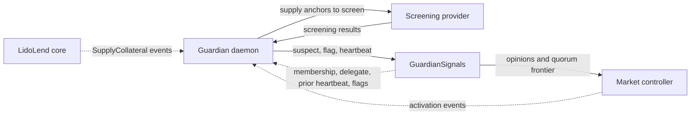

# Running a Lido Lend guardian

This guide is for guardian operators: members of a guardian committee registered in a `GuardianSignals` registry. A guardian screens new collateral supplies before the collateral can support borrowing, reports accounts it finds suspect or wants to flag, and sends heartbeats that tell market controllers how far it has screened.

The guide covers the guardian's job, the requirements, how to run the reference daemon from the `lidofinance/lend-guardian-daemon` SDK, and how to handle failures. See [Guardian signals](../architecture/guardian-signals) for the mechanism.

:::note
Guardian membership is a governance decision. The committee manager adds, replaces and removes guardians in the registry. See [Committees](../governance/committees) and [Roles and permissions](../governance/roles-and-permissions).
:::

## What a guardian does

A market controller divides a borrower's collateral into dust, activating and active balances. New collateral that reaches the activation threshold (`minActivationAmount`) enters an **activating lot** and gives no borrow capacity until the lot matures. The delay gives guardians time to screen the supply transactions behind the lot.

A guardian writes three kinds of report to `GuardianSignals`:

| Report | Call | Effect in the controller |
| --- | --- | --- |
| Flag | `flag(marketId, onBehalf, accounts)` | Adds one strike per distinct guardian. Each strike can add activation delay. Strikes at quorum ban the account: it cannot borrow and its activating lot cannot mature |
| Suspect report | `suspect(marketId, onBehalf, accounts)` | Can add activation delay to lots that started before the report snapshot expires. It never bans |
| Heartbeat | `heartbeat(onBehalf, lastScannedBlock, data)` | Records how far the guardian has screened. The registry combines current heartbeats into a quorum frontier |

A lot matures only when its unlock time has passed, the market is not frozen, the borrower is not banned, and either the stored quorum frontier has reached the unlock time or `maxGuardiansQuorumDelay` has passed since the lot started. A heartbeat is therefore an attestation: it tells controllers that all screening due through the reported block is complete. A heartbeat sent too early can let unscreened collateral become active.

A ban does not block repayment, liquidation, settlement or a debt-free collateral withdrawal.

A heartbeat is not scoped to one market. Before it sends a heartbeat, the guardian must complete screening through the reported block for every market whose controller uses the registry.

## Prerequisites

- **Membership.** Your guardian address is a current member of the target registry (`isGuardian(guardian)` returns `true`). We recommend a cold address for the guardian identity, preferably a multisig;
- **Delegate.** A separate hot address that the daemon uses to sign routine transactions, appointed by the guardian with `setDelegate(newDelegate)`. The delegate must be used by this daemon only. A delegate cannot be another guardian or another guardian's delegate;
- **Deployment inputs.** The `LidoLend` core address, the `GuardianSignals` registry address and the deployment block of each. The core is listed on [Deployed contracts](../deployed-contracts), and the registry of a market on the page of that market;
- **RPC endpoints** that meet the [RPC requirements](#rpc-requirements) below;
- **A screening provider** that you integrate through the SDK's `ScreeningProvider` interface. The protocol does not prescribe a provider;
- **Runtime.** Node.js 24 or newer and viem `^2.55.19` (the SDK is tested with 2.55.19);
- **ETH** on the delegate to pay for reports and heartbeats;
- **The scan cadence and reporting SLA of the market.** The guardian specification requires every `suspect` and `flag` report, and the secondary review of each report, to finish within this SLA. The scan cadence, the reporting and secondary-review SLA and the `txConfirmationBlocks` value depend on the market and are listed on the market page.

## How it works

The daemon reads `SupplyCollateral` events from the core and the collateral lifecycle events from each controller (`CollateralDusted`, `CollateralActivating`, `CollateralActivated`, `CollateralDrained`). It writes only to `GuardianSignals`.



Each cycle has five phases:

1. **Choose the coverage blocks.** The daemon selects a report block a few blocks behind the head. It recovers the previous heartbeat block from the latest `Heartbeat` event. If no reusable heartbeat exists, it anchors discovery at the latest `GuardianAdded` event for the guardian;
2. **Find candidate positions.** The daemon searches from 50,400 blocks (at least seven days) before the previous heartbeat block, or before `GuardianAdded`, for activating lots whose base deadline is at or before the report block;
3. **Build the work set.** The daemon reconstructs each candidate position at the report block and finds every supply transaction (an **anchor**) that can still contribute to its activating balance;
4. **Screen.** The daemon sends the anchors to the screening provider. Anchors of a borrower that this guardian has already flagged are not sent. Every other anchor needs one complete result;
5. **Report and heartbeat.** The daemon sends the required `suspect` reports, then the `flag` reports, waits for their confirmations, and then sends the heartbeat for the report block. The heartbeat's `data` carries a 32-byte coverage digest that commits to the complete work set.

With an empty work set, the daemon sends a heartbeat only when no heartbeat exists or the idle-heartbeat interval has passed since the stored one. The reference value of that interval is 12 hours.

Independent monitoring can rebuild the work set from chain history, compute the same digest and compare it with `Heartbeat.data`.

## Steps

### 1. Appoint the delegate

From the guardian address, call `setDelegate(newDelegate)` on the registry before the first cycle. Only the guardian can appoint, replace or clear its delegate. The delegate passes the guardian address as `onBehalf` in report and heartbeat calls, so the reports stay attached to the guardian identity.

A compromised delegate can also call `unsuspect` and `unflag` and retract the guardian's reports. Replace a compromised delegate at once. Delegate rotation does not make the heartbeats that the old delegate sent trustworthy.

### 2. Install the SDK

Install a pinned commit from the public repository:

```bash
npm install git+https://github.com/lidofinance/lend-guardian-daemon.git#b566e019684568e1d505ff25f77b3da4e61fe095
```

The package is named `guardian-daemon-sdk`. It has two entry points:

- `guardian-daemon-sdk/core` exports `Guardian`, the screening interface, phase outcomes, shared types and the generic RPC interfaces;
- `guardian-daemon-sdk/clients` exports `ViemRpcClient`, `createViemRpcTransport` and `LogsNotConfirmedError`.

The reference application is [`example/daemon.ts`](https://github.com/lidofinance/lend-guardian-daemon/blob/b566e019684568e1d505ff25f77b3da4e61fe095/example/daemon.ts). Copy it into your project and change the imports to the two package entry points. Its `createGuardian` function shows the full `Guardian` configuration.

### 3. Implement the screening provider

Replace the placeholder in [`example/screening-adapter.ts`](https://github.com/lidofinance/lend-guardian-daemon/blob/b566e019684568e1d505ff25f77b3da4e61fe095/example/screening-adapter.ts). The shipped placeholder returns `incomplete` for every anchor, so it never clears a deposit.

```ts
import type { ScreeningProvider, ScreeningRequest, ScreeningResult } from 'guardian-daemon-sdk/core';

export class YourScreeningProvider implements ScreeningProvider {
  async screen(request: ScreeningRequest): Promise<readonly ScreeningResult[]> {
    // Return one result per anchor, in the order of request.anchors.
    return Promise.all(
      request.anchors.map(async (anchor): Promise<ScreeningResult> => {
        // Screen anchor.transactionHash / anchor.borrower with your provider here.
        // If no decision can be established (timeout, missing answer), return incomplete:
        // return { status: 'incomplete' };
        return { status: 'judged', requiresSuspect: false, requiresFlag: false, evidenceReference: null };
      }),
    );
  }
}

export const screening: ScreeningProvider = new YourScreeningProvider();
```

- Each anchor identifies one `SupplyCollateral` log: `core`, `blockHash`, `transactionHash`, `logIndex`, `marketId` and `borrower`;
- a timeout, a missing answer or an unknown result must stay `incomplete`. An incomplete result blocks the heartbeat;
- `evidenceReference` is an optional, non-secret identifier of the provider's evidence. Keep it for investigations;
- the provider owns deduplication, concurrency limits, caching and risk policy.

### 4. Configure and run in observe mode

The example reads its configuration from environment variables:

| Variable | Meaning |
| --- | --- |
| `MODE` | `observe` (default) or `signal` |
| `CHAIN_ID` | `1` (mainnet, default) or `560048` (Hoodi) |
| `RPC_URLS` | Comma-separated HTTP(S) endpoints, in fallback order |
| `RPC_LOG_QUORUM` | Number of endpoints that must return the same logs, from 2 to the number of `RPC_URLS` |
| `GUARDIAN` | Registered guardian address |
| `LIDO_LEND`, `GUARDIAN_SIGNALS` | Core and registry addresses |
| `LIDO_LEND_DEPLOYMENT_BLOCK`, `GUARDIAN_SIGNALS_DEPLOYMENT_BLOCK` | Deployment blocks, used as scan floors |
| `SIGNER_KEY` | Signal mode only: the 32-byte private key of the delegate |

Start in observe mode. It creates no signer and sends no transactions:

```bash
MODE=observe node example/daemon.ts
```

Check the reconstructed anchors and the proposed `suspect` and `flag` counts. An observation does not advance onchain coverage.

### 5. Switch to signal mode

When the provider is in place and the observed results are correct, supply `SIGNER_KEY` from your secret manager and run:

```bash
MODE=signal node example/daemon.ts
```

The example rejects a `SIGNER_KEY` that belongs to the guardian itself and requires a separate delegate.

### 6. Run cycles without gaps

Run one cycle at a time. Pass the last confirmed heartbeat block as the hint for the next cycle:

```ts
let previousHeartbeatBlock: BlockRef | null = null;
const outcome = await guardian.cycle(previousHeartbeatBlock);
if ('previousHeartbeatBlock' in outcome) {
  previousHeartbeatBlock = outcome.previousHeartbeatBlock;
}
```

- A `stale` or `incomplete` outcome carries the attempt's `work`. Pass it to the next attempt as the second argument of `cycle`, so the retry walks only what changed;
- start the daemon as soon as the guardian is added, and keep it running. The first cycle covers 50,400 blocks before `GuardianAdded`, and each later cycle covers everything since the last heartbeat;
- each attempt must send its heartbeat while the report block is at most `256 - heartbeatReserveBlocks` blocks behind the head, because the registry checks the block hash with `blockhash`. With the example's reserve of 8 blocks and 12-second slots, that is 248 blocks, just under 50 minutes. Alert when the time from `cycle.started` to `cycle.finished` nears this budget, or on a `stale` outcome with `report-block-aged-out`.

### 7. Review reports and retract when needed

Each confirmed `suspect` or `flag` enters a secondary review that the guardian defines. The review checks the provider's decision outside the scan cycle, within the market's SLA:

- if the review confirms the concern, follow the agreed Lido incident-response path and submit `flag` where only `suspect` exists;
- if the review does not support the report, submit `unsuspect` or `unflag`.

`unflag` retracts the guardian's flag but does not lift a ban. If the account is already banned, `unflag` writes the ban latch. Only an account with `ACCESS_RESTORER_ROLE` can lift a ban with `unban`.

### 8. Handle membership changes

- A newly added guardian starts with no delegate and no heartbeat. Appoint the delegate before the first cycle;
- a delegate change keeps the guardian's reports and stored heartbeat. The next cycle continues from the same previous heartbeat;
- before the guardian is removed, stop the daemon, discard any running scan plan and resolve every pending transaction. Removal clears the delegate and the stored heartbeat; existing reports stay onchain. If the same address is added again, it starts as a new guardian.

## RPC requirements

A cycle relies on complete data from one consistent chain. The daemon cannot tell an empty `eth_getLogs` answer from an answer that left logs out, and a missing log can leave a supply unscreened while the heartbeat attests its coverage. The application that runs the daemon is responsible for log completeness.

- The RPC layer must support block headers, historical `eth_getLogs` and `eth_call` pinned to a block hash;
- registry logs must be available from the registry deployment block, and core and controller logs from the core deployment block;
- every endpoint must return every log that matches a request, in every block up to its head;
- if any endpoint can answer a request for blocks after its head without an error, set `logQuorum` (`RPC_LOG_QUORUM`) to 2 or more. A hosted provider endpoint can do this unless the provider guarantees the error for every backend behind it. The quorum needs at least two URLs;
- for production signal mode, use at least three endpoints from different providers with `logQuorum: 2`, so reads continue while one provider is down.

```ts
createViemRpcTransport({
  urls: [firstProviderUrl, secondProviderUrl, thirdProviderUrl],
  logQuorum: 2,
  // the other options are unchanged
});
```

`logQuorum` compares only `eth_getLogs` answers. It cannot detect a log that every answering provider omits.

## Errors and edge cases

The daemon must not send a heartbeat while any required data, screening result or report confirmation is missing. Retry timing and limits are the operator's choice.

| Failure | Cause | What to do |
| --- | --- | --- |
| `guardian-not-member`, `delegate-mismatch`, or a write reverts with `Unauthorized()` | The guardian is not a member, or the configured delegate differs from `getDelegate(guardian)` | Stop writes. Start a new cycle only after membership, delegate and signer configuration agree |
| `incomplete` outcome | A screening result is missing or not complete | The SDK sends the reports that complete results require and withholds the heartbeat. Pass `work` to the next attempt |
| RPC or screening request fails; `node-behind-the-plan`, `position-without-history`, `position-history-broken`, `log-not-canonical` | Missing or inconsistent chain data | No heartbeat over the affected coverage. Check the endpoints and retry |
| `stale` with `report-block-aged-out`, `report-block-reorged` or `head-not-past-report-block` | The report block is too old, no longer canonical, or not older than the head | Rebuild coverage for a new report block (the next attempt does this) |
| `stale` with `stored-heartbeat-moved`; heartbeat reverts with `InvalidBlockHash()`, `BlockInTheFuture()`, `TimestampInTheFuture()` or `HeartbeatTimestampRegressed()` | The stored heartbeat changed during the attempt, or the reported block failed registry checks | Rebuild coverage for a valid report block. Check that no other tool sends heartbeats for this guardian |
| `stale` with `report-no-longer-confirmed`; `report-confirmation-timeout` | A required report is missing, failed, reorged out, or below `txConfirmationBlocks` confirmations | Do not send the heartbeat until every report is confirmed |
| `report-receipt-foreign` | A receipt does not match the report this signer sent in this attempt | Check the client and the signer |
| Signing timeout, signer out of ETH, transaction stuck below the fee level, out-of-gas | Delivery failure | Do not send the heartbeat until all required writes are confirmed. After a failed attempt that reached sending, call `guardian.clearPendingNonces()` before the next cycle |

Other notes:

- `clearPendingNonces()` is safe only for a dedicated signer. If pending transactions cannot be cleared, the example exits with code 1; reconcile the signer before a restart;
- any other tool or person that sends a heartbeat for this guardian makes the same attestation, and later cycles skip the anchors it covers;
- reports and the heartbeat are separate transactions. A reorg deeper than `txConfirmationBlocks` can remove a report and keep the heartbeat;
- a guardian-supplied heartbeat timestamp is not checked against the block header. The frontier trusts the quorum of guardian identities;
- the heartbeat's `data` payload is unauthenticated guardian data. The registry emits it in the `Heartbeat` event and does not read it.

## Related

- [Guardian signals](../architecture/guardian-signals)
- [Market controller](../architecture/market-controller)
- [Committees](../governance/committees)
- [Roles and permissions](../governance/roles-and-permissions)
- [Guardian specification 0.3.0](https://github.com/lidofinance/lend-guardian-daemon/blob/b566e019684568e1d505ff25f77b3da4e61fe095/docs/guardian-specification.md)
- [Guardian daemon SDK README](https://github.com/lidofinance/lend-guardian-daemon/blob/b566e019684568e1d505ff25f77b3da4e61fe095/README.md)
- [Reference application guide](https://github.com/lidofinance/lend-guardian-daemon/blob/b566e019684568e1d505ff25f77b3da4e61fe095/example/README.md)
- [`GuardianSignals` specification](https://github.com/lidofinance/lend-markets/blob/main/docs/specs/guardian-signals.md)
