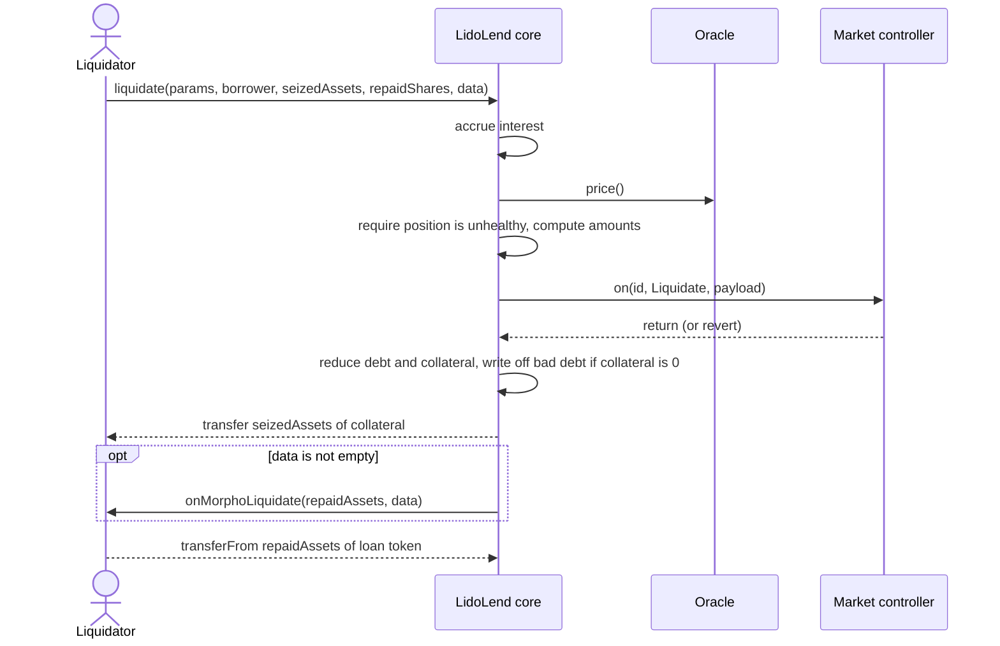

# Liquidating Lido Lend positions

This guide is for liquidators and searchers. Lido Lend keeps the Morpho Blue liquidation rules in the core. When a borrower's debt exceeds the LLTV-adjusted value of its collateral, anyone can call `liquidate` and repay part or all of the debt. The liquidator may receive collateral with a liquidation incentive.

The guide describes the liquidation rules, the Lido Lend controller rules that affect liquidation, and how to find, size and execute a liquidation. For core accounting, see [Core](../architecture/core).

## Prerequisites

- The `LidoLend` core address from [Deployed contracts](../deployed-contracts);
- the market id and `MarketParams` of each market you watch. You can read `MarketParams` from the core with `idToMarketParams(id)`;
- loan tokens to repay the debt, or a contract that implements `onMorphoLiquidate` and sources the loan tokens inside the callback;
- an allowance of the loan token from the liquidating address to the core. The core pulls the repaid assets with `transferFrom` at the end of the call;
- for a market with transfer-restricted collateral, a liquidating address that the collateral token allows to receive transfers.

No role, registration or authorization is needed: `liquidate` has no caller check.

## How it works

### Health and liquidation threshold

A position is healthy when:

```text
borrowed  = ceil(borrowShares * (totalBorrowAssets + 1) / (totalBorrowShares + 1e6))
maxBorrow = floor(floor(collateral * oraclePrice / 1e36) * lltv / 1e18)
healthy  ⇔ maxBorrow >= borrowed
```

`collateral` is the borrower's full collateral balance in the core, including collateral that the controller does not yet count as active. A position with zero borrow shares is always healthy. The oracle price is in loan-token raw units per collateral raw unit, scaled by `1e36`.

### Liquidation incentive

The liquidation incentive factor (`LIF`) depends only on the market's LLTV:

```text
LIF = min(1.15, 1 / (1 - 0.3 * (1 - LLTV)))
```

A lower LLTV gives a higher `LIF`, up to the 1.15 cap. Ignoring rounding, the liquidator receives collateral worth `LIF` times the repaid debt.

### Two ways to size a liquidation

`liquidate(marketParams, borrower, seizedAssets, repaidShares, data)` takes exactly one non-zero amount:

| Input | Core computes |
| --- | --- |
| `seizedAssets > 0`, `repaidShares = 0` | `repaidShares = toSharesUp(ceil(ceil(seizedAssets * price / 1e36) * 1e18 / LIF))` |
| `repaidShares > 0`, `seizedAssets = 0` | `seizedAssets = floor(floor(toAssetsDown(repaidShares) * LIF / 1e18) * 1e36 / price)` |

`LIF` is WAD-scaled (`1e18` is 1).

The function returns `(seizedAssets, repaidAssets)`. `repaidAssets` is the repaid shares converted to assets, rounded up.

### Execution order



Because the collateral arrives before the loan tokens are pulled, a callback contract can convert the seized collateral into loan tokens inside `onMorphoLiquidate`. When the callback runs, the controller hook has already returned and the hook lock is clear, so a nested core action in the callback runs its own controller hook.

### Bad debt

If a liquidation leaves the borrower with zero collateral, the core writes off the remaining borrow shares. Their asset value, capped by the market's `totalBorrowAssets`, is removed from both total borrow and total supply assets, so lenders bear the loss. The liquidator does not pay for this debt. The `Liquidate` event reports it as `badDebtAssets` and `badDebtShares`.

This loss can occur while the debt is still below 100% of the collateral value: exhausting the collateral can repay at most `collateralValue / LIF`.

### What the market controller changes

A market created without a controller skips the `LidoLendMarketController` policy. When a market has a controller, the core calls it before the liquidation writes. The controller cannot change the amounts the core resolved. For a liquidation it:

- reverts while the controller is paused, as for every hooked action;
- reverts with `PositionAccountingMismatch()` if the resolved amounts exceed the borrower's borrow shares or collateral;
- removes the seized collateral from the borrower's activation balances: active first, then dust, then activating. It does not mature an activating lot first and ignores the activation lock;
- updates the borrower's entry in the settlement queue.

The controller does **not**:

- check guardian bans: a banned borrower can be liquidated, and the caller is not checked for a ban;
- apply the borrow-share-rate guard: a liquidation may move the market above the guard's ceiling;
- block liquidation while the market is frozen.

| Market state | Liquidation |
| --- | --- |
| Normal | Allowed |
| Frozen | Allowed |
| Controller paused | Blocked: the hook reverts |
| Oracle reverts | Blocked: the core cannot read the price |

A finite pause ends on its own at `getResumeSinceTimestamp()`. An indefinite pause needs an authorized resume. Interest keeps accruing during a pause, and the next successful accrual covers the whole period. See [Market controller](../architecture/market-controller) for freeze and pause.

### Collateral activation

New collateral enters the core at once and counts toward the core health check, even while the controller treats it as inactive for borrowing. Activation therefore does not make a position liquidatable earlier. A liquidation can seize inactive collateral after the active balance is used up. See [Market controller](../architecture/market-controller) for collateral activation.

### Settlement

Settlement is a lender-exit path, not a liquidation. It cancels debt against a lender's supply and transfers collateral at the oracle price with no incentive, and the core does not check borrower health for it. It affects liquidators in two ways:

- a partial settlement removes the same value from debt and collateral. For a position below 100% LTV this lowers LTV, so a settlement can make an unhealthy position healthy before your transaction lands;
- every settlement path is blocked while the queue root has bad debt. Liquidation stays available and can clear that state.

See [Settlement](../architecture/settlement).

## Steps

### 1. Find candidates

- Index `Borrow`, `Repay`, `SupplyCollateral`, `WithdrawCollateral`, `Liquidate` and `Settle` events from the core to keep a set of borrowers with debt;
- the market controller's `settlementBorrowers(offset, maxCount)` returns tracked borrowers and their risk keys (`borrowShares * 1e18 / rawCollateral`, rounded down) in approximate top-down order. `settlementBorrowersCount()` gives the queue size. The order is approximate and the key is rounded, so check each position yourself;
- `positionOf(borrower)` on the controller returns a one-call snapshot of a borrower, including the collateral split and debt.

### 2. Check health off-chain

The stored market totals exclude interest accrued since `lastUpdate`, so this check can understate the debt. Simulate the call (step 3) before you send it.

```ts
import { ethers } from "ethers";

const core = new ethers.Contract(coreAddr, [
  "function idToMarketParams(bytes32) view returns (address loanToken,address collateralToken,address oracle,address irm,uint256 lltv)",
  "function position(bytes32,address) view returns (uint256 supplyShares,uint128 borrowShares,uint128 collateral)",
  "function market(bytes32) view returns (uint128 totalSupplyAssets,uint128 totalSupplyShares,uint128 totalBorrowAssets,uint128 totalBorrowShares,uint128 lastUpdate,uint128 fee)",
  "function marketController(bytes32) view returns (address)",
  "function liquidate((address,address,address,address,uint256),address,uint256,uint256,bytes) returns (uint256,uint256)",
], signer);

const WAD = 10n ** 18n;
const SCALE = 10n ** 36n;
const mulDivDown = (x, y, d) => (x * y) / d;
const mulDivUp = (x, y, d) => (x * y + d - 1n) / d;

const params = await core.idToMarketParams(marketId);
const pos = await core.position(marketId, borrower);
const m = await core.market(marketId);
const oracle = new ethers.Contract(params.oracle, ["function price() view returns (uint256)"], provider);
const price = await oracle.price();

const borrowed = mulDivUp(pos.borrowShares, m.totalBorrowAssets + 1n, m.totalBorrowShares + 10n ** 6n);
const maxBorrow = mulDivDown(mulDivDown(pos.collateral, price, SCALE), params.lltv, WAD);
const liquidatable = pos.borrowShares > 0n && borrowed > maxBorrow;

// The controller must not be paused.
const controller = new ethers.Contract(await core.marketController(marketId), [
  "function isPaused() view returns (bool)",
], provider);
const paused = await controller.isPaused();
```

### 3. Simulate and liquidate from an account

Approve the loan token to the core once, simulate, then send:

```ts
const marketParams = [params.loanToken, params.collateralToken, params.oracle, params.irm, params.lltv];

// repay a chosen number of borrow shares; seizedAssets = 0
const [seized, repaid] = await core.liquidate.staticCall(marketParams, borrower, 0n, repaidShares, "0x");
await (await core.liquidate(marketParams, borrower, 0n, repaidShares, "0x")).wait();
```

Expected result: the borrower's debt falls by `repaidShares`, `seized` collateral arrives at the liquidator, and `repaid` loan tokens leave it. The core emits `Liquidate(id, caller, borrower, repaidAssets, repaidShares, seizedAssets, badDebtAssets, badDebtShares)`.

### 4. Liquidate without upfront loan tokens

Pass non-empty `data` and implement `IMorphoLiquidateCallback`. The core sends the collateral, calls `onMorphoLiquidate(repaidAssets, data)`, and then pulls `repaidAssets` of the loan token from your contract.

```solidity
// SPDX-License-Identifier: GPL-2.0-or-later
pragma solidity ^0.8.0;

// Interfaces from lidofinance/lend (src/interfaces/)
import {IMorpho, MarketParams} from "lend/src/interfaces/IMorpho.sol";
import {IMorphoLiquidateCallback} from "lend/src/interfaces/IMorphoCallbacks.sol";

interface IERC20Approve {
    function approve(address spender, uint256 amount) external returns (bool);
}

contract Liquidator is IMorphoLiquidateCallback {
    IMorpho public immutable CORE;
    address public immutable OWNER;

    constructor(IMorpho core) {
        CORE = core;
        OWNER = msg.sender;
    }

    function liquidate(MarketParams calldata params, address borrower, uint256 repaidShares) external {
        require(msg.sender == OWNER, "not owner");
        // The core pulls repaidAssets of the loan token from this contract after the callback.
        IERC20Approve(params.loanToken).approve(address(CORE), type(uint256).max);
        CORE.liquidate(params, borrower, 0, repaidShares, abi.encode(params));
    }

    function onMorphoLiquidate(uint256 repaidAssets, bytes calldata data) external {
        require(msg.sender == address(CORE), "not core");
        MarketParams memory params = abi.decode(data, (MarketParams));
        // The seized collateral (params.collateralToken) is already on this contract.
        // Convert enough of it into `repaidAssets` of params.loanToken here, with a route of your choice.
    }
}
```

## Errors and edge cases

| Error | Cause | What to do |
| --- | --- | --- |
| `position is healthy` | The position is healthy at the accrued state and current price | Re-check; a repayment, collateral supply, settlement or price change may have restored it |
| `inconsistent input` | Both or neither of `seizedAssets` and `repaidShares` are zero | Pass exactly one non-zero amount |
| `market not created` | Wrong `MarketParams` | Read them with `idToMarketParams(id)` |
| `PositionAccountingMismatch()` | Resolved amounts exceed the borrower's borrow shares or collateral, for example after a small repayment front-ran the call | Re-size against the latest position |
| Panic `0x11` (arithmetic underflow) | The same over-sizing, in a market without a controller | Re-size against the latest position |
| `ResumedExpected()` | The market controller is paused | Wait for the pause to end |
| `hook reentrancy` | The liquidation was started from inside a controller hook | Do not start a hooked action from within a hook |
| Token transfer failure (`transfer reverted`, `transferFrom reverted`, or a token-specific error) | The collateral token rejected the transfer to the liquidator, or the loan-token allowance or balance is too low | Use an eligible liquidating address; approve and fund the loan token |
| Oracle revert | The oracle cannot return a usable price | Liquidation is blocked until the oracle recovers |

Other notes:

- **Front-running.** A small repayment by anyone before your transaction can make an exact full-size liquidation revert;
- **Zero-collateral debt after settlement.** If a settlement took all of a borrower's collateral and left borrow shares, a liquidator can clear the remaining debt from a helper contract. In one transaction, the helper adds one raw unit of collateral for the borrower, then calls `liquidate` with `seizedAssets = 1` and `repaidShares = 0`. If the borrower stays unhealthy and the derived `repaidShares` do not exceed its remaining borrow shares, the helper gets the unit back, pays the computed loan-token amount, and the bad-debt branch writes off the rest. The controller must accept both hooks, and the collateral token must allow the transfers. For dust-sized debt, `repay` is the simpler path;
- **Price jumps.** The inherited safety model assumes that the oracle price cannot drop below its previous value times `LLTV * LIF` at once. A larger jump can move a position past the point where liquidation covers the debt.

## Related

- [Core](../architecture/core)
- [Market controller](../architecture/market-controller)
- [Settlement](../architecture/settlement)
- [Risks](../risks)
- [Lido Lend core specification](https://github.com/lidofinance/lend/blob/422d589f9d098124249b54b55306884165833207/SPECIFICATION.md)
- [`LidoLend.sol`](https://github.com/lidofinance/lend/blob/422d589f9d098124249b54b55306884165833207/src/LidoLend.sol)
- [Market controller specification](https://github.com/lidofinance/lend-markets/blob/main/docs/specs/market-controller.md)
