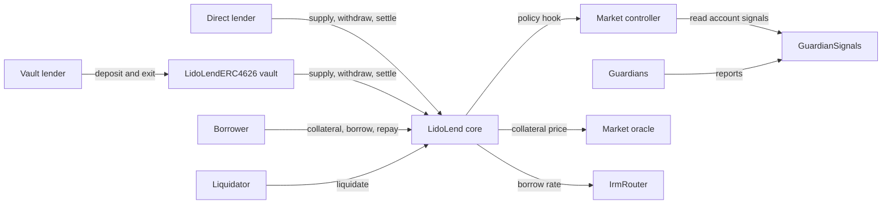

# Introduction

Lido Lend is a lending protocol of isolated markets. Its core contract, `LidoLend`, is a fork of [Morpho Blue](https://github.com/morpho-org/morpho-blue/tree/1478e9cfe1b4d514f80682b3b60e4e12ff3ee45a) and keeps Morpho's isolated-market accounting. A Lido policy layer adds per-market rules on top: a supply cap, delayed collateral activation, guardian signals, freeze and pause controls, and additional exit paths for lenders. The Lido DAO governs the protocol.

This page is for anyone new to Lido Lend: lenders, borrowers, integrators and governance participants.

## How it works

Each market lets lenders supply one loan token and lets borrowers borrow that token against one collateral token. A market also selects an oracle, an interest-rate model (IRM) and a liquidation loan-to-value (LLTV). The oracle values collateral in loan-token units. The IRM sets how debt and lender claims grow over time. LLTV is the borrowing limit that the core health check uses.

When debt exceeds the LLTV-adjusted collateral value, anyone can liquidate the position. The liquidator repays debt and may receive collateral. The payout includes a liquidation incentive that depends on the market's LLTV. If a liquidation uses all the collateral and debt remains, the core writes that debt off against the market's suppliers.

Five fields identify a market: `loanToken`, `collateralToken`, `oracle`, `irm` and `lltv`. Positions and totals are isolated by market, so assets in one market do not back positions in another. One core contract holds all markets and is the source of truth for balances, shares and token custody. Token custody is shared by token address.

In a market with a controller, the core calls the controller before most actions. The controller allows the action or reverts it. It cannot change the amounts that the core calculates, spend user tokens or act for user accounts.

For the full system model, see [Architecture](./architecture) and the [architecture specification](https://github.com/lidofinance/lend-markets/blob/main/docs/specs/architecture.md).

## What is different from Morpho Blue

The fork of the core makes four changes to Morpho Blue (see [FORK_NOTES](https://github.com/lidofinance/lend/blob/422d589f9d098124249b54b55306884165833207/FORK_NOTES.md)):

- only the core owner can create markets, and `enableIrm` and `enableLltv` are removed;
- a market can be bound to a controller when it is created, and the core calls that controller before most market actions;
- a new `settle` function lets a lender exit against borrower collateral;
- the core runs behind a proxy and is initialized once in proxy storage.

The Lido layer adds these contracts and mechanisms:

- **Market controller.** `LidoLendMarketController` applies the policy of one market: supply cap, collateral activation, guardian-based borrow gating, freeze and pause, and settlement policy. See [Market controller](./architecture/market-controller);
- **Collateral activation.** New collateral counts in the core health check at once, but it supports new borrowing only after an activation delay. See [Market controller](./architecture/market-controller);
- **Guardian signals.** Guardians report on accounts and on their review progress through `GuardianSignals`. Reports can delay collateral activation or ban new borrowing. They cannot seize collateral. See [Guardian signals](./architecture/guardian-signals);
- **Settlement and lender exits.** A lender can cancel a borrower's debt against its own supply and receive collateral of the same oracle value, with no liquidation incentive. `LidoLendERC4626` vaults add a fallback exit that pays free liquidity first and settles the rest. See [Settlement](./architecture/settlement);
- **Governance-managed IRM.** The `irm` field of a standard market points to `IrmRouter`, which forwards rate calls to a selected model such as `AdaptiveCurveIrm`. Governance roles can change the route and the model configuration after market creation. See [Interest rate model](./architecture/interest-rate-model).

## For lenders

A lender supplies the loan token directly to the core and receives supply shares, or deposits into a `LidoLendERC4626` vault and receives transferable ERC-4626 shares. Borrowers can use the supplied tokens, so a lender may not be able to withdraw the full claim at once.

Main constraints and options:

- a supply cap can limit new supply to a market;
- an ordinary withdrawal is limited by the free liquidity of the market;
- when liquidity is short, a lender can exit through settlement if the market enabled it at creation, or through the vault fallback exit;
- lenders bear the debt that remains after a liquidation uses all of a borrower's collateral.

See [Settlement](./architecture/settlement) and [Risks](./risks).

## For borrowers

A borrower supplies collateral, borrows the loan token and repays the debt. The whole collateral balance protects the position from liquidation. Only active collateral counts toward new borrowing.

Main constraints:

- new collateral goes through an activation delay before it supports new borrowing. The delay grows with recent collateral inflow to the market, and guardian reports can extend it;
- a guardian ban blocks new borrowing and stops collateral activation, but it does not directly block repayment or a debt-free collateral withdrawal;
- a market freeze stops new borrowing, collateral activation and collateral withdrawal while debt remains;
- a position with debt above its LLTV-adjusted collateral value can be liquidated;
- in a market with settlement enabled, a lender can cancel part of a borrower's debt and take collateral of the same oracle value. Without borrower action, this applies only to the borrower at the root of the risk queue, which is ordered by estimated LTV. A borrower can also opt in by setting a personal target LTV.

See [Market controller](./architecture/market-controller), [Guardian signals](./architecture/guardian-signals) and [Liquidations](./guides/liquidations).

## Governance and safety

- **Lido DAO.** The Lido DAO Agent is the initial proxy admin of the core, the IRM router and the market contracts, and it administers the privileged roles. Until a proxy is ossified, its admin can replace the contract code;
- **Lend Operational Committee.** In the intended setup, routine configuration goes through predefined Easy Track motions that execute through the `EVMScriptExecutor`. This covers market activation, supply caps, activation and settlement configuration, fees, IRM configuration, guardian membership, unbans and unfreezing;
- **Lend Risk Steward Committee.** In the intended setup, it is appointed as the steward of each market in `RiskStewardDashboard`. As a steward, it can only tighten a market: freeze it, increase activation delays, the activation lock or the minimum deposit, or revoke instant activation;
- **Emergency pause.** `CircuitBreaker` lets a registered emergency actor apply one finite pause to a market controller. The Reseal Manager can extend the pause or end it early;
- **Guardians.** Guardians report account risk and review progress through `GuardianSignals`. Flags from a quorum of distinct guardians ban an account in a market.

No role other than proxy administration can directly rewrite or redirect a core or vault position. For the full role map, see [Roles and permissions](./governance/roles-and-permissions) and [Committees](./governance/committees). For audits and bug bounty, see [Audits](./audits) and [Security](./security).

## Where to go next

- **Integrators:** [Architecture](./architecture), [Bundler integration](./guides/bundler-integration), [Deployed contracts](./deployed-contracts);
- **Lenders and borrowers:** [Risks](./risks), [Liquidations](./guides/liquidations);
- **Guardian operators:** [Guardian operator guide](./guides/guardian-operator), [Guardian signals](./architecture/guardian-signals);
- **Governance participants:** [Roles and permissions](./governance/roles-and-permissions), [Committees](./governance/committees), [Market onboarding](./governance/market-onboarding), [Audits](./audits), [Security](./security);
- **Terms:** [Glossary](./glossary).

The full specifications are in the [lend-markets specs](https://github.com/lidofinance/lend-markets/blob/main/docs/specs/README.md), the [core specification](https://github.com/lidofinance/lend/blob/422d589f9d098124249b54b55306884165833207/SPECIFICATION.md) and the [IRM specification](https://github.com/lidofinance/lend-irm/blob/566d31f7dfdf83d07a6593f641f7474c263a7f89/SPECIFICATION.md).
